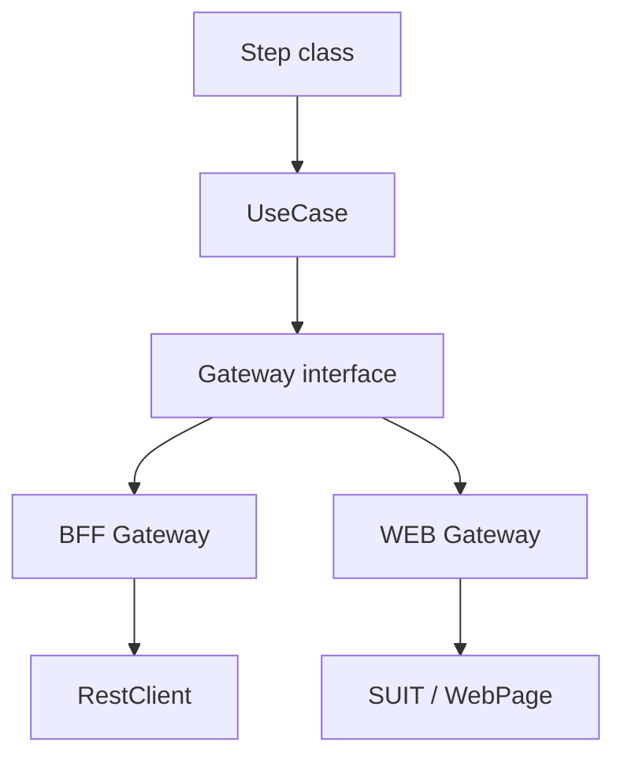

# Product Module Architecture

This document describes the Clean Architecture structure used inside product modules such as `interop` and `send`.

The goal is to keep business intent independent from the execution channel and to isolate technical details inside the infrastructure layer.

This document defines structure and dependency direction.
[Component responsibilities](component-responsibilities.md) is the normative ownership reference;
[Test implementation flow](../flows/test-implementation-flow.md) explains how to apply it.
Existing code is evidence for an audit, not an automatic exception to the intended architecture.

## Product module structure

A product module is organized first by execution channel and then vertically by business entity or capability.

Typical top-level structure:

```text
<product-module>/
├── common/
├── bff/
└── web/
```

Each vertical slice applies Clean Architecture:

```text
<channel-or-common>/<business-entity>/
├── domain/
├── application/
└── infrastructure/
```

## Channel scope

### `common`

Contains capabilities that are shared across multiple execution channels.

Business concepts and application contracts should live here whenever they are channel-agnostic.

This is the product-common package, not the repository's shared Maven module `common/`.
See [Repository map](repository-map.md#shared-module-versus-product-common-package).

### `bff`

Contains BFF-specific infrastructure implementations.

Typical responsibilities include:

- Gateway implementations for the BFF channel
- RestClient implementations
- request/response mapping
- channel-specific factories
- technical configuration

### `web`

Contains WEB-specific infrastructure implementations.

Typical responsibilities include:

- Gateway implementations for the WEB channel
- Page Objects
- reusable UI components
- SUIT-based interactions
- technical configuration

## Clean Architecture layers

### `domain`

Contains domain entities modeled specifically for the QA suite.

These models represent the business concepts used by tests and must remain independent from technical channel models.

Example:

```text
common/agreement/domain/
├── Agreement.java
├── AgreementRef.java
└── AgreementCreationFailureReason.java
```

### `application`

Contains the application-level business abstractions.

Typical contents include:

- UseCases
- Gateway interfaces
- optional Factory interfaces
- optional Command interfaces
- application Journeys and lifecycle planners where a reusable business composition or plan is needed

A UseCase represents a high-level business intent and works with domain entities.

Example:

```java
@Service
@RequiredArgsConstructor
public class AgreementUseCase {

    private final AgreementGateway agreementGateway;

    public Agreement createAgreement(
            EService eService,
            EServiceDescriptor descriptor,
            @Nullable Delegation delegation) {

        return agreementGateway.createAgreement(
                eService,
                descriptor,
                delegation
        );
    }
}
```

The UseCase must not contain technical details related to HTTP, browser automation, selectors, generated
payloads, technical polling, or concrete channel implementations.
A business wait may express a business condition while delegating channel reads and synchronization to Gateways.

### `infrastructure`

Contains concrete technical implementations.

Typical contents include:

- Cucumber Step classes and parameter types
- Gateway implementations
- RestClients
- Page Objects and SUIT-based components
- Spring configuration
- mappers
- concrete factories
- other channel-specific technical components

Infrastructure translates application-level business intent into concrete technical interactions.

The current structure also includes channel-specific command implementations under channel `application`
packages. They may wrap generated payloads while implementing common contracts; common callers must not
depend on those concrete types. This does not permit an `application` package to depend on `infrastructure`.

Global `infrastructure` and `kernel` packages are supported alongside vertical slices.
Use them for genuinely shared technical wiring or foundational concepts, not as escape hatches for
unrelated dependencies. Vertical slices should not reach into another slice's concrete infrastructure
from their common application/domain.

## Dependency direction

Dependencies must point inward toward the business model.

```text
infrastructure -> application -> domain
```

The `domain` layer must not depend on `application` or `infrastructure`.

The `application` layer may depend on `domain`, but must not depend on concrete infrastructure implementations.

The `infrastructure` layer may depend on both `application` and `domain`.

## Business flow

The architectural flow for a business operation is:



The same business contract is implemented independently by each execution channel.

The arrows in this flow show runtime collaboration. They are not Java dependency arrows:
concrete Gateways implement common interfaces, and common application code does not import BFF/WEB adapters.
An optional Journey composes application operations before the Gateway boundary.

## UseCase responsibility

A UseCase represents a business desire at a high level.

Its method signatures should remain coarse-grained and business-oriented.

Because the repository is a test suite, UseCases may also model negative business expectations.

Example:

```java
public void shouldFailToCreateAgreement(
        EService eService,
        EServiceDescriptor descriptor,
        @Nullable Delegation delegation,
        AgreementCreationFailureReason reason) {

    agreementGateway.shouldFailToCreateAgreement(
            eService,
            descriptor,
            delegation,
            reason
    );
}
```

Negative expectations must expose an explicit failure `Reason`, so the expected failure remains understandable at business level.

## Gateway responsibility

The Gateway interface belongs to the `application` layer.

Each execution channel provides its own implementation in `infrastructure`.

Conceptually:

```text
UseCase
   ↓
Gateway interface
   ↓
┌───────────────────┬───────────────────┐
│ BFF Gateway       │ WEB Gateway       │
│       ↓           │       ↓           │
│ RestClient        │ SUIT / WebPage    │
└───────────────────┴───────────────────┘
```

A Gateway is responsible for:

- adapting the business request to the underlying channel
- mapping technical models to domain entities
- managing QA-specific infrastructure concerns
- updating shared test contexts such as the `EntityStore`
- handling polling and synchronization when required
- delegating low-level channel interaction to RestClient or SUIT/Page components

The UseCase must remain unaware of these technical details.

Endpoint composition is not Journey composition. A BFF operation can call different endpoints for an ordinary
e-service and a template instance while fulfilling the same application command.
The Gateway owns the adaptation and subsequent context refresh, not the UseCase or Journey.
See [Context ownership](component-responsibilities.md#context-ownership-and-object-lifetime).

## BFF infrastructure

The BFF Gateway uses a RestClient.

The RestClient is a QA abstraction built around an API client generated through OpenAPI Generator and configured with RestAssured.

Conceptually:

```text
BFF Gateway
  ↓
RestClient
  ↓
Generated OpenAPI client
  ↓
RestAssured
```

The RestClient exposes a fluent interface that allows recurring QA infrastructure concerns to be expressed declaratively.

Example:

```java
restClient.create(payload)
        .withPolling(PollingStrategy.UNTIL_SUCCESS)
        .map(...)
        .get();
```

Here the RestClient returns the chain; the Gateway chooses synchronization, mapping and context updates.
The presence of a fluent chain does not move those responsibilities into the RestClient.

## WEB infrastructure

The WEB Gateway implements the same application contract through the frontend channel.

It delegates browser interaction to Page Objects and reusable components built on top of SUIT.

Conceptually:

```text
WEB Gateway
  ↓
Page Object / component
  ↓
SUIT
  ↓
Browser
```

The business contract remains stable while the channel-specific implementation changes.

## Enforcement and review

`interop` has an [ArchitectureRulesTest](../../interop/src/test/java/it/pagopa/interop/architecture/ArchitectureRulesTest.java)
covering selected package, dependency, naming and size constraints. Its scope is not the whole architecture:
context ownership, cohesion, semantic correctness of commands and retry suitability require additional review
and focused regressions.

Use the [Architecture health checklist](architecture-health-checklist.md) to distinguish current automated
checks from manually assessed boundaries and design signals. This documentation does not add new executable
rules or claim that every product module has the same automated coverage.
