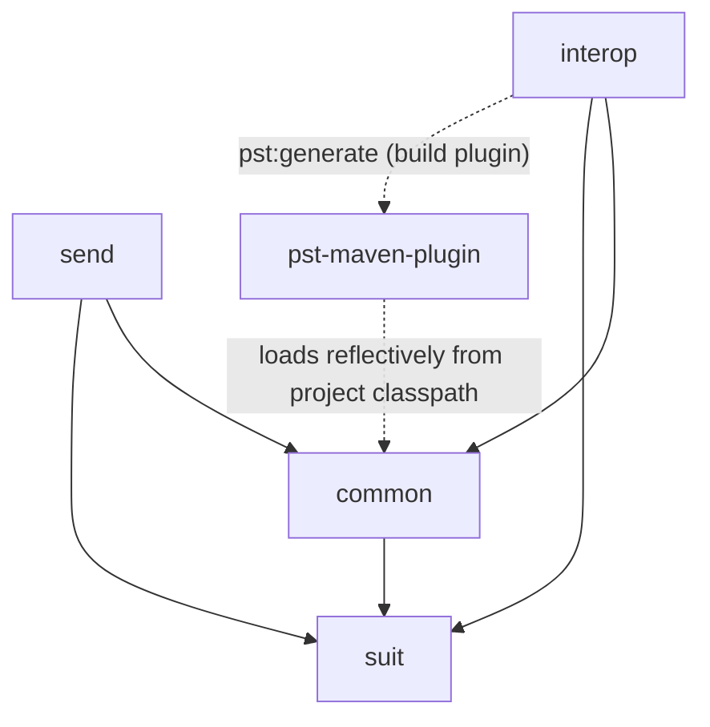

# Repository Map

This diagram shows the main internal modules of the repository and their dependency relationships.

Convention:

`A --> B` means **A depends on B**.

## Module roles

* `suit`: shared UI test automation framework.
* `common`: shared infrastructure, utilities, and reusable components used across product-specific modules. It depends on suit only where common UI components are implemented using framework abstractions.
* `interop`: Interop-specific test implementation.
* `send`: SEND-specific test implementation.
* `pst-maven-plugin`: Maven orchestration of the PST generator (`pst:generate`). It has no compile dependency on `common`: it loads the PST launcher from the consumer project classpath. See [PST generator](../guides/contract/pst-generator.md).

## Module boundaries
* `suit` must not contain product-specific logic.
* `common` must contain only functionality that is shared or intended to be reusable across product-specific modules.
* `interop` must contain Interop-specific behavior and test implementation.
* `send` must contain SEND-specific behavior and test implementation.
* Product-specific modules may depend on common and suit.
* Shared modules must not depend on product-specific modules.

## Shared module versus product-common package

The Maven module `common/` and the package `it.pagopa.interop.common` have different scopes:

| Scope | Purpose | Must not contain |
|---|---|---|
| Repository module `common/` | Infrastructure/utilities reusable across products | Dependencies on `interop` or `send`, Interop business rules |
| `interop` package `it.pagopa.interop.common` | Interop domain and application contracts independent of execution channel | Dependencies from common application/domain to BFF/WEB technical implementations or generated clients |
| `interop` channel packages such as `bff` and `web` | Concrete adaptations of Interop capabilities | Business rules duplicated solely to select endpoints or selectors |

Being shared between BFF and WEB does not make an Interop concept cross-product infrastructure.
Likewise, moving a class into `kernel` does not make an otherwise invalid dependency acceptable.

See [Product module architecture](product-module-architecture.md) for package boundaries,
[Component responsibilities](component-responsibilities.md) for ownership rules, and the
[Architecture health checklist](architecture-health-checklist.md) for review criteria.