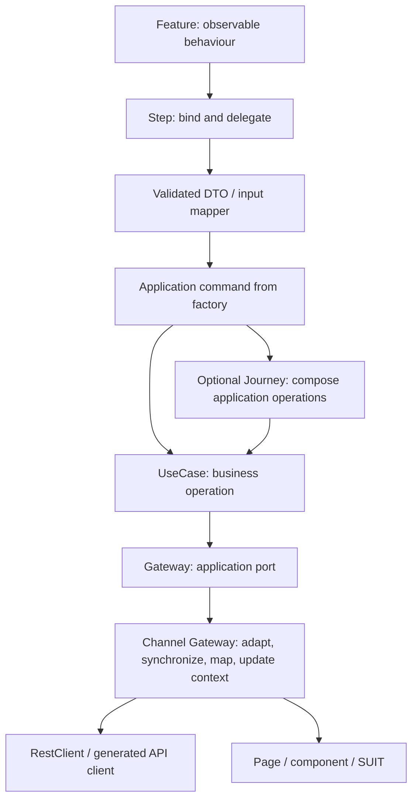

# Test Implementation Flow

This flow applies the [component responsibilities](../architecture/component-responsibilities.md)
and [product-module structure](../architecture/product-module-architecture.md).
It separates business intent from channel adaptation and makes verification side effects explicit.

## Classify the requirement

Identify the observable behaviour, preconditions, expected failure reasons and supported channels.
Distinguish business tests from technical contract tests; JUnit alone does not determine the test level.
Confirm environment prerequisites instead of inferring them from a tenant name, enum or default fixture.

Before adding components, look for existing commands, factories, UseCases, Journeys, Gateway operations,
mappers and channel clients. Reuse the business capability, not only a similar HTTP call.
Missing contract information or environment decisions must be reported rather than invented.

## Business flow



This is a collaboration diagram, not a dependency graph. Optional DTOs, commands and Journeys are used
when the input or orchestration warrants them; do not introduce an empty layer at every arrow.

## Place each decision

| Question | Owner |
|---|---|
| What should the user observe? | Feature and application expectation |
| Is the table syntactically valid? | Cucumber DTO / validator |
| Which registered entity does an alias denote? | Input conversion / parameter type |
| Which remote fixture satisfies a prerequisite? | Application operation through a Gateway |
| What values describe the requested action? | Application command |
| What explicit defaults or independent request copies are needed? | Factory |
| Which business rules or transitions must hold? | UseCase / domain / lifecycle planner |
| Which reusable sequence of application operations obtains the setup? | Journey |
| Which endpoint(s) or UI interactions fulfil the action? | Channel Gateway |
| What headers, path parameters and body are sent? | RestClient |
| How is eventual visibility synchronized? | Gateway |
| How is a response merged into a domain aggregate and stored? | Mapper policy and Gateway context update |
| How are resources retired and the session restored? | Hook orchestration delegating application operations |

### Example: descriptor publication

The scenario asks for a published descriptor. The application orchestrates preparation and publication
using its commands and lifecycle rules. It does not introduce an endpoint-specific business action.

The BFF adapter determines whether preparation uses the ordinary descriptor API or the template-instance API,
maps the supported fields, performs the required calls and refreshes the entity context.
The WEB adapter fulfils the same supported intention through page/component interactions.
Neither adapter pretends an unsupported channel capability succeeded.

Register the scenario alias against the Gateway-stored entity. Do not rebuild or mutate a stale aggregate
in the Journey after the Gateway has replaced its snapshot.

## Lifecycle, fixtures and cleanup

Use genuine supported transitions and verify postconditions. A target enum value does not establish a
setup path. For example, scheduling retirement is not proof that terminal archiving has completed.

Declare prerequisite data, feature flags and permissions. Fail clearly when an essential precondition
cannot be established. Do not create remote data from a DTO mapper or silently select unrelated fixtures.
Keep randomized names compatible with the scenario's search terms and resolve expected entities by identity.

Register created resources early enough to clean them up after a later failure.
Hooks delegate cleanup, restore the original user/channel in all cases, and report aggregated failures.
Resource ownership must be scenario-scoped; a thread-local store alone does not establish that scope.

## Contract tests

Contract JUnit classes verify channel-specific protocol or UI contracts directly, without calling Cucumber glue.
Separate fixture setup from the operation whose request, status, payload or UI contract is being asserted.
Keep generated-operation naming and reporting conventions consistent with the architecture checks.

Unit tests and local transport/integration tests are distinct from live contract/business tests.
A mocked generated client or a local HTTP stub must not fall through to a configured remote environment.

## Verification before handoff

1. Test input validation and mapping, including omitted/empty/false values when their semantics differ.
2. Test application rules independently from channel transport.
3. Test adapter endpoint selection, payload/header construction, synchronization and context refresh locally.
4. Cover repeated operations where idempotent context updates, alias preservation or collection merging matter.
5. Run the smallest relevant local regressions and `ArchitectureRulesTest` for structural changes.

For offline Interop verification, select exact known-local classes:

```shell
mvn -o -q -f interop/pom.xml \
  -Dtest=ExactLocalTestClass,ArchitectureRulesTest \
  -Dcodegen.skip=true -Dexec.skip=true test
```

Replace the placeholder with actual local test class names. This command does not classify tests as safe:
inspect the selected classes and their setup first. Do not use broad selectors that can include live
Cucumber or contract suites. Live verification requires explicit environment scope and side-effect awareness.

Report separately: implementation coverage, local verification, live evidence and unresolved prerequisites.
Passing local mocks or architecture checks is not proof that a scenario passes in QA.
