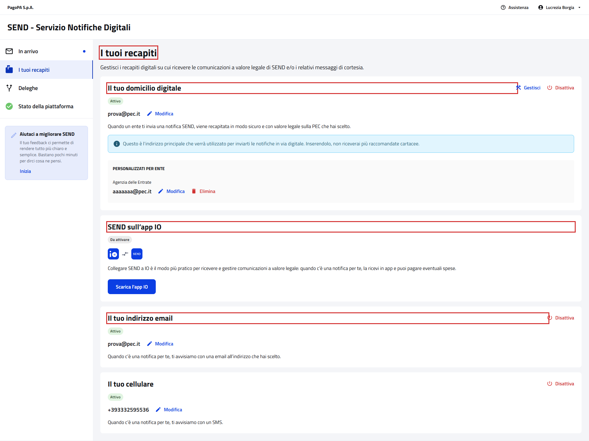
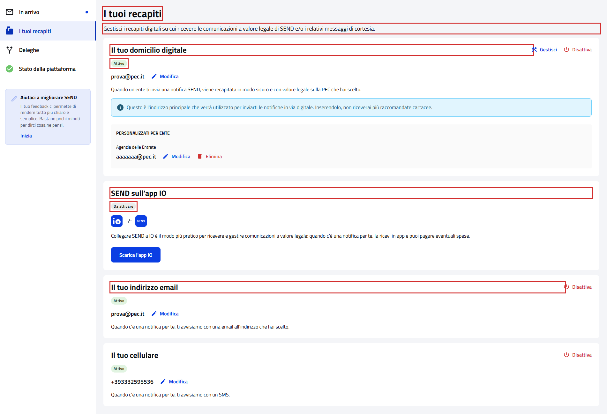

# I tuoi recapiti

Pagina `{baseUrl}/recapiti`, dalla voce "I tuoi recapiti" del menu laterale.

- Page object: [`AddressPFPage`](../../src/main/java/it/pagopa/send/web/destinatario_pf/infrastructure/page/AddressPFPage.java)
- Test: [`WebAddressPFContractTest`](../../src/test/java/it/pagopa/send/suite/contract/destinatario_pf/WebAddressPFContractTest.java)
- Utente: Lucrezia Borgia
- Navigazione: `WebRecipientPfNavigationContractTest#shouldReachAddressPF`, vedi
  [WebRecipientPfNavigationContractTest.md](WebRecipientPfNavigationContractTest.md#i-tuoi-recapiti)

## La pagina

In rosso quello che controlla `assertLoaded()`: il titolo e le card del domicilio digitale, dell'app IO e dell'email.
Lo usano anche gli step Cucumber dei recapiti.

## Cosa verifica il contract test

Solo quello che c'è per tutti gli utenti. In rosso gli elementi controllati.

| Parte | Cosa si controlla |
|---|---|
| Intestazione | titolo e sottotitolo |
| Card | titoli "Il tuo domicilio digitale", "SEND sull’app IO" e "Il tuo indirizzo email" |
| Stato | che ci sia lo stato del domicilio digitale e di SEND sull'app IO, senza guardarne il valore |

## Non verificato

Il contenuto delle card dipende dai recapiti dell'utente (attivi o da attivare) e non viene verificato: valori, pulsanti
Modifica, Gestisci e Disattiva, PEC personalizzate per ente, card del cellulare, campi per aggiungere i recapiti e i loro
messaggi di validazione.
