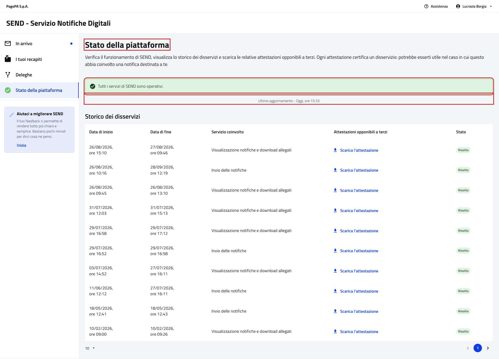
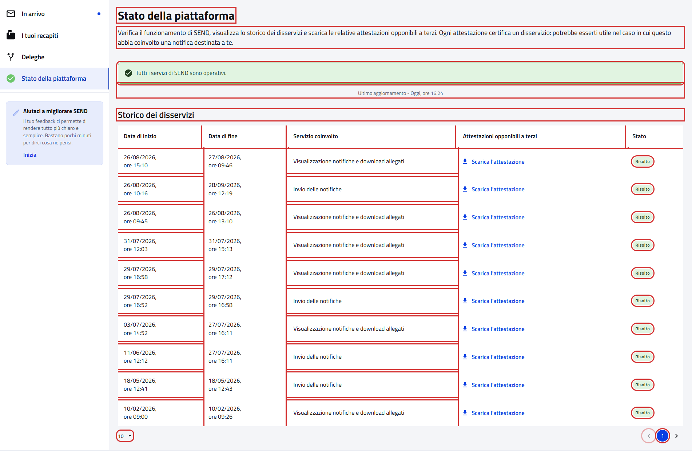

# Stato della piattaforma

Pagina `{baseUrl}/app-status`, dalla voce "Stato della piattaforma" del menu laterale.

- Page object: [`AppStatusPFPage`](../../src/main/java/it/pagopa/send/web/destinatario_pf/infrastructure/page/AppStatusPFPage.java)
- Test: [`WebAppStatusPFContractTest`](../../src/test/java/it/pagopa/send/suite/contract/destinatario_pf/WebAppStatusPFContractTest.java)
- Utente: Lucrezia Borgia (la pagina è uguale per tutti i cittadini)
- Navigazione: `WebRecipientPfNavigationContractTest#shouldReachAppStatusPF`, vedi
  [WebRecipientPfNavigationContractTest.md](WebRecipientPfNavigationContractTest.md#stato-della-piattaforma)

## La pagina

In rosso quello che controlla `assertLoaded()`: il titolo, lo stato attuale e l'ultimo aggiornamento.

## Cosa verifica il contract test

Stato e storico sono uguali per tutti gli utenti ma cambiano nel tempo: il test controlla i testi fissi e il formato dei
dati, non i valori. In rosso gli elementi controllati.

| Parte | Cosa si controlla |
|---|---|
| Intestazione | titolo, sottotitolo e titolo "Storico dei disservizi" |
| Stato attuale | che ci sia un messaggio: cambia se è in corso un disservizio |
| Ultimo aggiornamento | "Ultimo aggiornamento - &lt;giorno&gt;, ore hh:mm" |
| Storico | colonne e, per ogni riga, inizio `gg/mm/aaaa, ore hh:mm`, servizio e stato |
| Paginazione | 10 righe per pagina, prima pagina selezionata, "Indietro" disabilitato |

## Note

- Il test non scarica le attestazioni.
- La data di fine e "Scarica l'attestazione" ci sono solo per i disservizi risolti e non vengono verificati.
