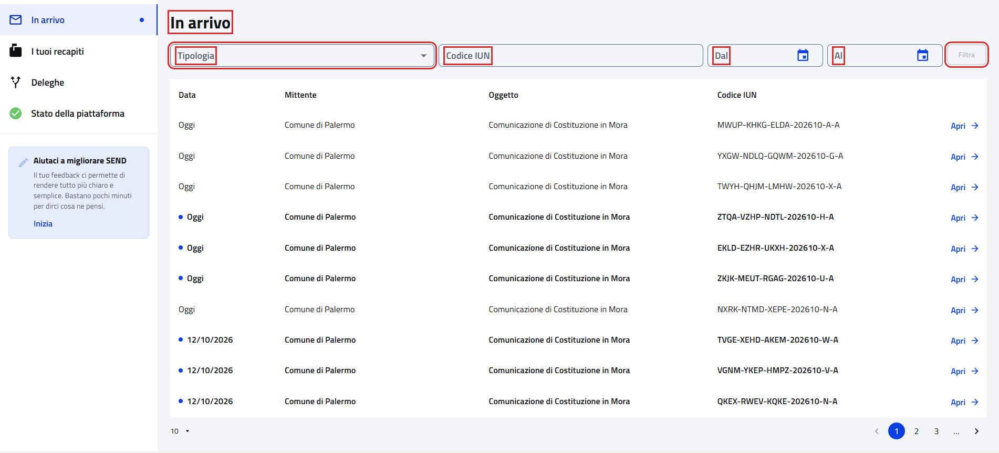

# In arrivo

Pagina `{baseUrl}/notifiche`: si apre dopo il login e dalla voce "In arrivo" del menu laterale.

- Page object: [`NotificationPFPage`](../../src/main/java/it/pagopa/send/web/destinatario_pf/infrastructure/page/NotificationPFPage.java)
- Test: [`WebNotificationPFContractTest`](../../src/test/java/it/pagopa/send/suite/contract/destinatario_pf/WebNotificationPFContractTest.java)
- Utente: Lucrezia Borgia
- Navigazione: `WebRecipientPfNavigationContractTest#shouldReachNotificationListPF`, vedi
  [WebRecipientPfNavigationContractTest.md](WebRecipientPfNavigationContractTest.md#in-arrivo)

## La pagina

In rosso quello che controlla `assertLoaded()`: il titolo e i campi dei filtri. Lo usano anche gli step Cucumber.

## Cosa verifica il contract test

Solo quello che c'è per tutti gli utenti: i testi della pagina e dei filtri, le opzioni di "Tipologia" e i messaggi dei
filtri. In rosso gli elementi controllati, esclusi i messaggi e i menu aperti.

| Parte | Cosa si controlla |
|---|---|
| Titolo | inizia con "In arrivo": chi ha deleghe a suo carico vede "In arrivo per te" |
| Filtri | etichette Tipologia, Codice IUN, Dal e Al; "Filtra" disabilitato |
| Tipologia | opzioni "Notifiche a valore legale" e "Comunicazioni" |
| Messaggi | "Inserisci un codice IUN valido" con IUN `abc`; "Inserisci una data compresa tra … e …" con una data di più di 10 anni fa o futura, calcolate dal giorno corrente |

## Non verificato

Dipendono dall'utente e non vengono verificati: la tabella delle notifiche con la paginazione e il filtro per
tipologia, e il banner "Niente più documenti cartacei", che compare solo a chi non ha un domicilio digitale.

## Note

- Il test non apre le notifiche, perché aprirle le segna come lette.
- Il titolo "In arrivo per te" è stato visto il 13/10/2026 con Giulio Cesare, che ha deleghe a suo carico.
