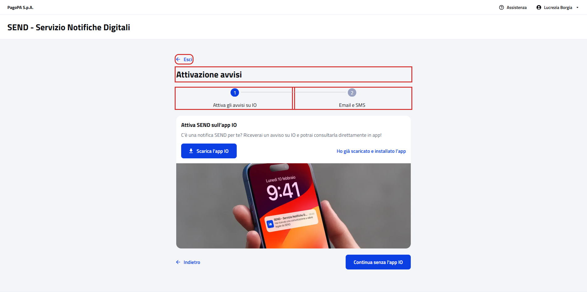
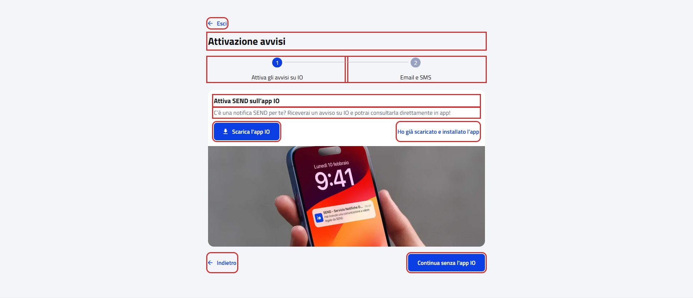
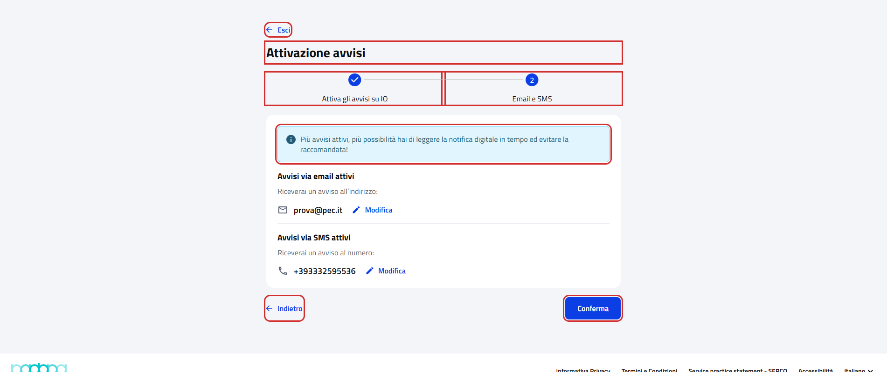

# Attivazione avvisi

Wizard di onboarding `{baseUrl}/onboarding/avvisi`, dalla card "Voglio solo gli avvisi" di Configura SEND.

- Page object: [`OnboardingAlertsPFPage`](../../src/main/java/it/pagopa/send/web/destinatario_pf/infrastructure/page/OnboardingAlertsPFPage.java)
- Test: [`WebOnboardingAlertsPFContractTest`](../../src/test/java/it/pagopa/send/suite/contract/destinatario_pf/WebOnboardingAlertsPFContractTest.java)
- Utente: Lucrezia Borgia
- Navigazione: `WebRecipientPfNavigationContractTest#shouldReachOnboardingAlertsPF`, vedi
  [WebRecipientPfNavigationContractTest.md](WebRecipientPfNavigationContractTest.md#onboarding-attivazione-avvisi)

## La pagina

In rosso quello che controlla `assertLoaded()`: che la pagina sia caricata. Ogni passo controlla solo di avere un
contenuto.

## Cosa verifica il contract test

Solo quello che c'è per tutti gli utenti. In rosso gli elementi controllati.

Passo 1, Attiva gli avvisi su IO:

Passo 2, Email e SMS:

| Parte | Cosa si controlla |
|---|---|
| Wizard | titolo, "Esci" e nomi dei passi "Attiva gli avvisi su IO" ed "Email e SMS" |
| 1. Attiva gli avvisi su IO | titolo, descrizione, "Scarica l’app IO", "Ho già scaricato e installato l’app", "Indietro" e "Continua senza l'app IO" |
| 2. Email e SMS | il banner "Più avvisi attivi…", "Indietro" e "Conferma" |

## Non verificato

Al passo 2 i blocchi dell'email e del cellulare dipendono dai recapiti dell'utente (recapito attivo con "Modifica"
oppure campo per inserirlo) e non vengono verificati, con i loro messaggi di validazione.

## Note

- Il test si sposta tra i passi con Indietro e Avanti, che non salvano nulla, e non preme "Conferma".
- Il passo 2 si raggiunge con "Continua senza l'app IO": provato il 13/10/2026 con Lucrezia Borgia e con Giulio Cesare.
- I testi del blocco "Attiva SEND sull'app IO" sono gli stessi di "Tutto, sull'app IO": le costanti sono in
  `OnboardingIoExpectedTexts`.
