# Navigazione del portale persone fisiche

`WebRecipientPfNavigationContractTest` apre ogni pagina del portale cittadini di SEND e controlla che il suo
`assertLoaded()` passi, cioè che la pagina sia caricata. Testi, contenuto e validazioni di ogni pagina li controllano i
contract test di pagina, elencati nella tabella.

Negli screenshot sono in rosso gli elementi controllati da `assertLoaded()` (o dal passo, per i wizard). Sono presi
sull'ambiente `test` con Lucrezia Borgia, a 1920x1080, e vanno rigenerati quando cambia un `assertLoaded()`. Ultimo
aggiornamento: 13/10/2026.

`{baseUrl}` è la proprietà `url.notifiche.cittadino.base` del profilo attivo, ad esempio
`https://cittadini.test.notifichedigitali.it` sul profilo `test`.

## Pagine

| Pagina | Indirizzo | Contract test |
|---|---|---|
| [In arrivo](#in-arrivo) | `/notifiche` | [`WebNotificationPFContractTest`](WebNotificationPFContractTest.md) |
| [I tuoi recapiti](#i-tuoi-recapiti) | `/recapiti` | [`WebAddressPFContractTest`](WebAddressPFContractTest.md) |
| [Attiva domicilio digitale su SEND](#attiva-domicilio-digitale-su-send) | `/recapiti/domicilio-digitale/attivazione` | [`WebDigitalDomicileActivationPFContractTest`](WebDigitalDomicileActivationPFContractTest.md) |
| [Deleghe](#deleghe) | `/deleghe` | [`WebDelegationsPFContractTest`](WebDelegationsPFContractTest.md) |
| [Aggiungi una delega](#aggiungi-una-delega) | `/deleghe/nuova` | [`WebNewDelegationPFContractTest`](WebNewDelegationPFContractTest.md) |
| [Configura SEND](#configura-send-onboarding) | `/onboarding` | [`WebConfigureAddressSendPFContractTest`](WebConfigureAddressSendPFContractTest.md) |
| [Il meglio di SEND](#onboarding-il-meglio-di-send) | `/onboarding/domicilio-digitale` | nessuno, vedi sotto |
| [Attivazione avvisi](#onboarding-attivazione-avvisi) | `/onboarding/avvisi` | [`WebOnboardingAlertsPFContractTest`](WebOnboardingAlertsPFContractTest.md) |
| [Tutto, sull'app IO](#onboarding-tutto-sullapp-io) | `/onboarding/io` | [`WebOnboardingIoPFContractTest`](WebOnboardingIoPFContractTest.md) |
| [Stato della piattaforma](#stato-della-piattaforma) | `/app-status` | [`WebAppStatusPFContractTest`](WebAppStatusPFContractTest.md) |
| [Assistenza](#assistenza) | `/assistenza` | [`WebSupportPFContractTest`](WebSupportPFContractTest.md) |
| [I tuoi dati](#i-tuoi-dati) | `/profilo` | [`WebProfilePFContractTest`](WebProfilePFContractTest.md) |
| [Termini di servizio](#termini-di-servizio) | `/termini-di-servizio` | [`WebTermsOfServicePFContractTest`](WebTermsOfServicePFContractTest.md) |
| [Termini di servizio SERCQ](#termini-di-servizio-sercq) | `/termini-di-servizio/sercq-send` | [`WebSercqTermsOfServicePFContractTest`](WebSercqTermsOfServicePFContractTest.md) |

Le pagine che esistono solo se l'utente ha dei dati non hanno contract test e non sono nella navigazione: dettaglio di
una notifica (`/notifiche/<IUN>/dettaglio`), stato della notifica (`/notifiche/<IUN>/dettaglio/timeline`) e gestione del
domicilio digitale (`/recapiti/domicilio-digitale/gestione`). I loro page object restano per i test di business.

## In arrivo

`shouldReachNotificationListPF`, page object [`NotificationPFPage`](../../src/main/java/it/pagopa/send/web/destinatario_pf/infrastructure/page/NotificationPFPage.java).

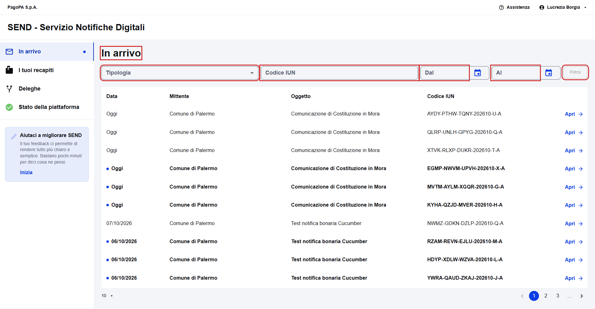

## I tuoi recapiti

`shouldReachAddressPF`, page object [`AddressPFPage`](../../src/main/java/it/pagopa/send/web/destinatario_pf/infrastructure/page/AddressPFPage.java).

## Attiva domicilio digitale su SEND

`shouldReachDigitalDomicileActivationPF`, page object [`DigitalDomicileActivationPFPage`](../../src/main/java/it/pagopa/send/web/destinatario_pf/infrastructure/page/DigitalDomicileActivationPFPage.java).

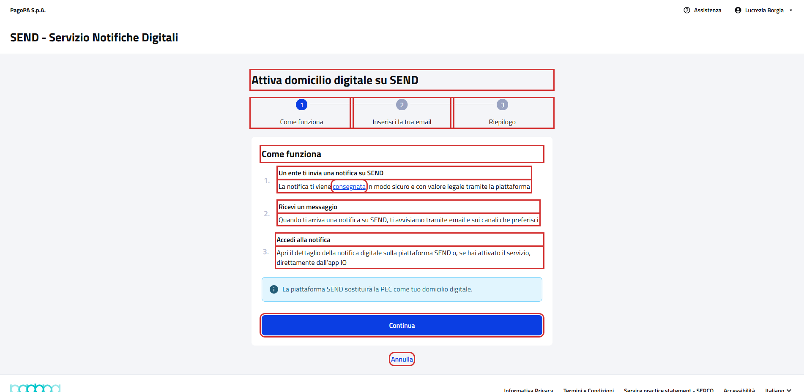

## Deleghe

`shouldReachDelegationsPF`, page object [`DelegationsPFPage`](../../src/main/java/it/pagopa/send/web/destinatario_pf/infrastructure/page/DelegationsPFPage.java).

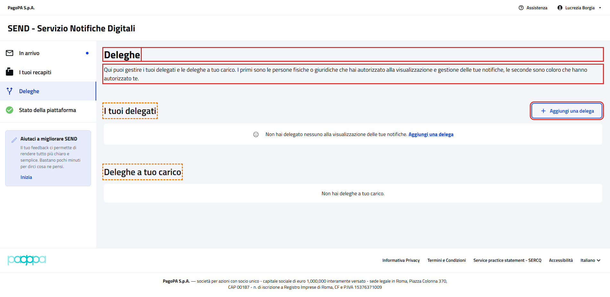

## Aggiungi una delega

`shouldReachNewDelegationPF`, page object [`NewDelegationPFPage`](../../src/main/java/it/pagopa/send/web/destinatario_pf/infrastructure/page/NewDelegationPFPage.java).

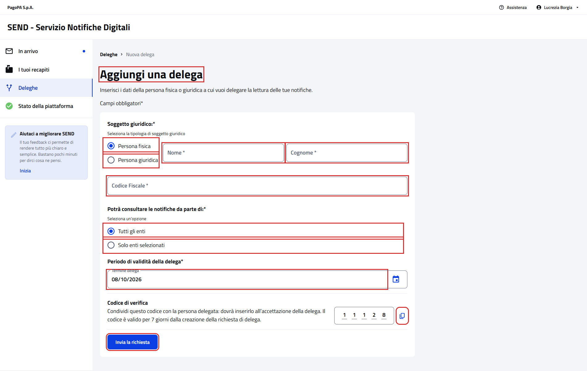

## Configura SEND (onboarding)

`shouldReachOnboardingPF`, page object [`ConfigureAddressSendPage`](../../src/main/java/it/pagopa/send/web/infrastructure/page/ConfigureAddressSendPage.java).

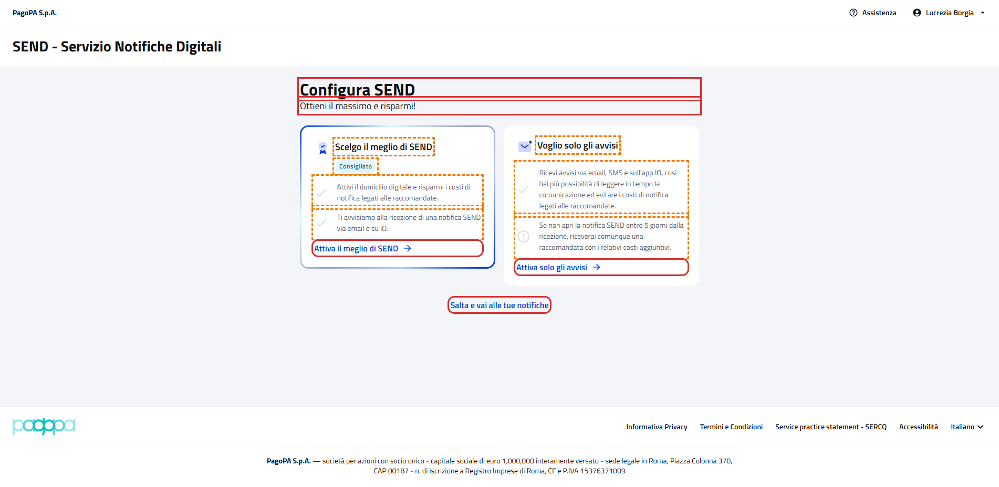

## Onboarding: Il meglio di SEND

`shouldReachOnboardingDigitalDomicilePF`, page object [`OnboardingDigitalDomicilePFPage`](../../src/main/java/it/pagopa/send/web/destinatario_pf/infrastructure/page/OnboardingDigitalDomicilePFPage.java).

Non ha un contract test: il contenuto dei passi dipende dai recapiti dell'utente, e il titolo, "Esci" e i nomi dei
quattro passi li controlla già `assertLoaded()`.

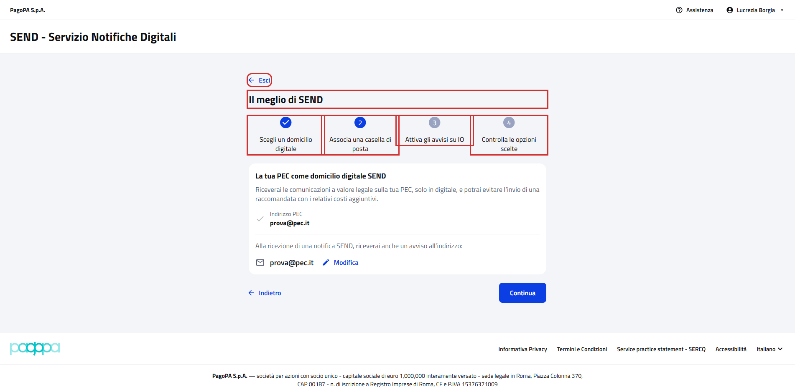

## Onboarding: Attivazione avvisi

`shouldReachOnboardingAlertsPF`, page object [`OnboardingAlertsPFPage`](../../src/main/java/it/pagopa/send/web/destinatario_pf/infrastructure/page/OnboardingAlertsPFPage.java).
Controlla i due passi, raggiunti con Indietro e Avanti, senza premere "Conferma".

Passo 1, Attiva gli avvisi su IO (`IoSection`):

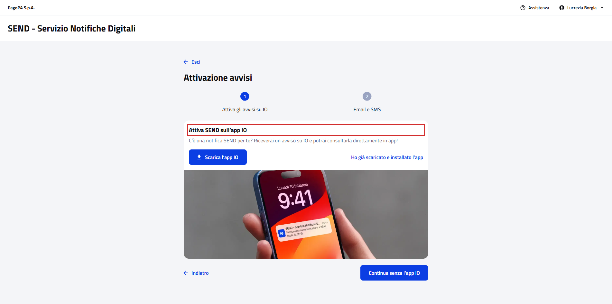

Passo 2, Email e SMS (`EmailSmsSection`):

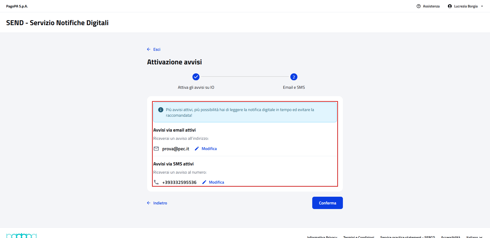

## Onboarding: Tutto, sull'app IO

`shouldReachOnboardingIoPF`, page object [`OnboardingIoPFPage`](../../src/main/java/it/pagopa/send/web/destinatario_pf/infrastructure/page/OnboardingIoPFPage.java).
Il test apre la pagina dall'indirizzo. Nel portale ci si arriva solo dalla terza card di Configura SEND, che vede solo
chi non ha recapiti di cortesia.

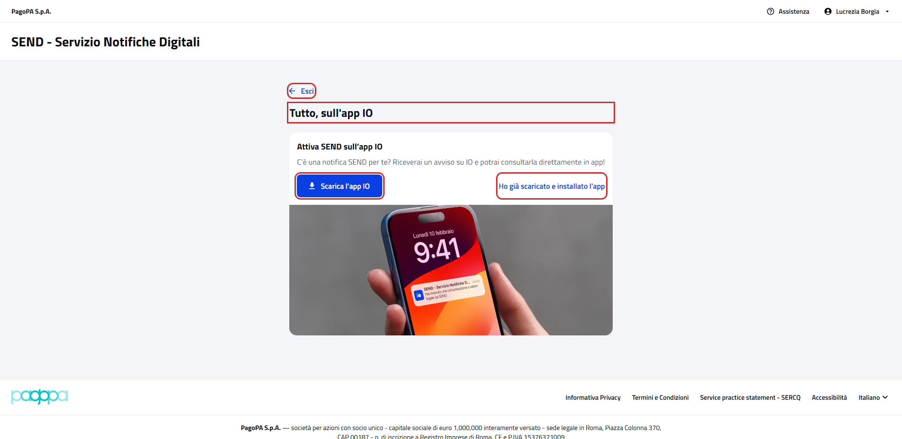

## Stato della piattaforma

`shouldReachAppStatusPF`, page object [`AppStatusPFPage`](../../src/main/java/it/pagopa/send/web/destinatario_pf/infrastructure/page/AppStatusPFPage.java).

## Assistenza

`shouldReachSupportPF`, page object [`SupportPFPage`](../../src/main/java/it/pagopa/send/web/destinatario_pf/infrastructure/page/SupportPFPage.java).

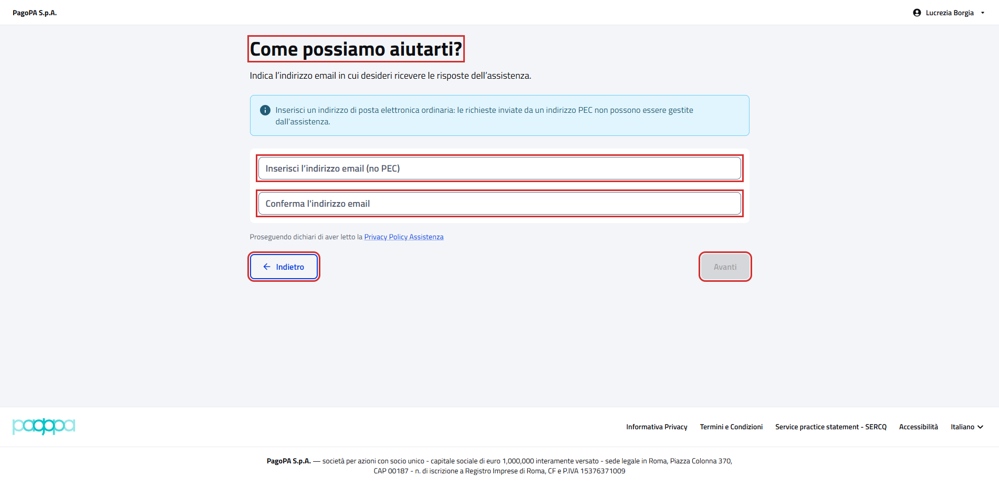

## I tuoi dati

`shouldReachProfilePF`, page object [`ProfilePFPage`](../../src/main/java/it/pagopa/send/web/destinatario_pf/infrastructure/page/ProfilePFPage.java).

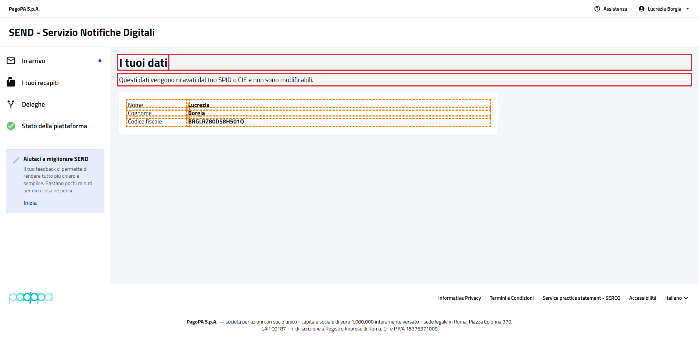

## Termini di servizio

`shouldReachTermsOfServicePF`, page object [`TermsOfServicePFPage`](../../src/main/java/it/pagopa/send/web/destinatario_pf/infrastructure/page/TermsOfServicePFPage.java).

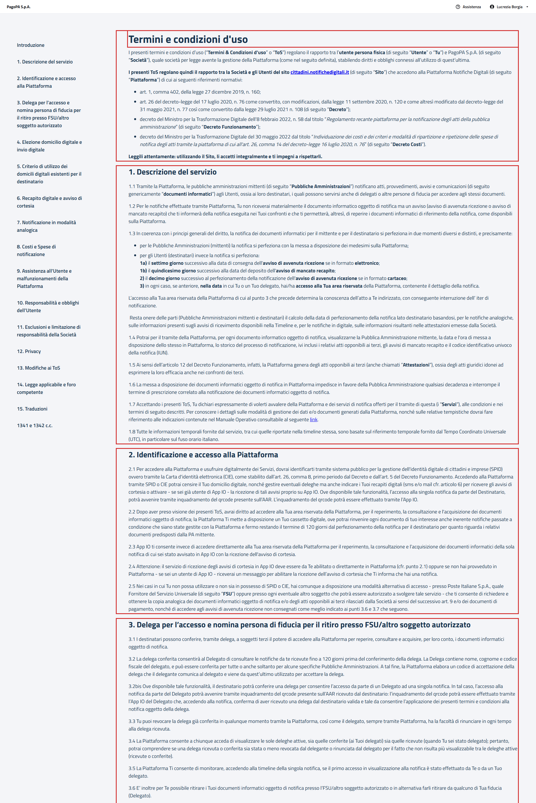

## Termini di servizio SERCQ

`shouldReachSercqTermsOfServicePF`, page object [`SercqTermsOfServicePFPage`](../../src/main/java/it/pagopa/send/web/destinatario_pf/infrastructure/page/SercqTermsOfServicePFPage.java).

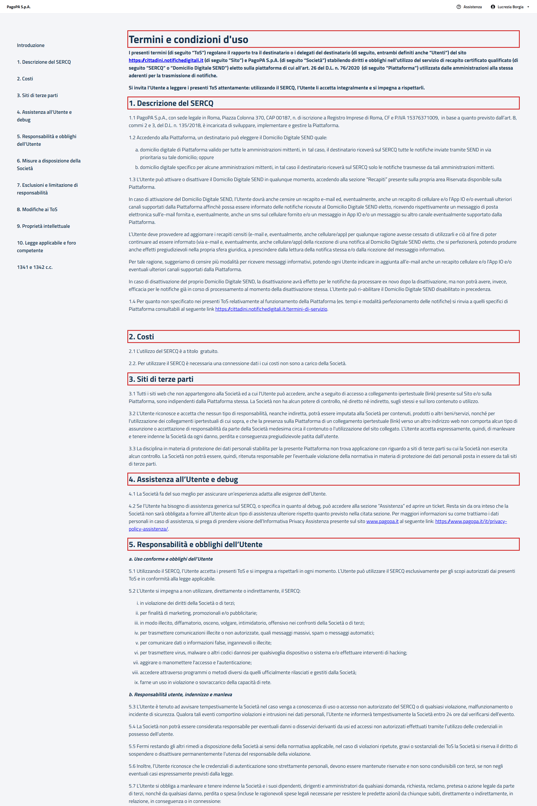
