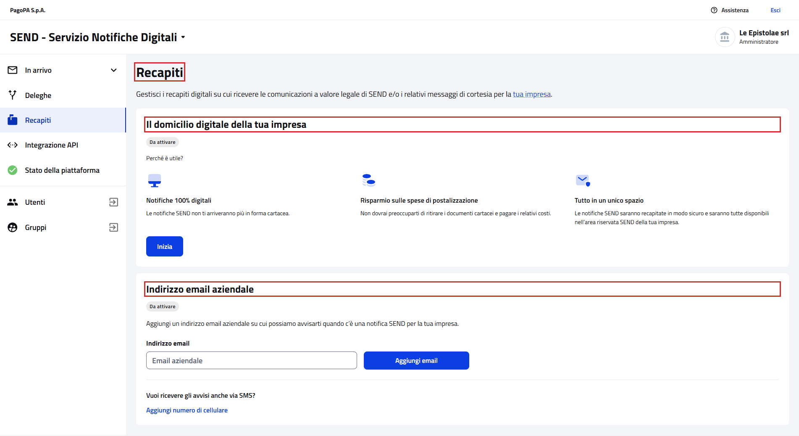
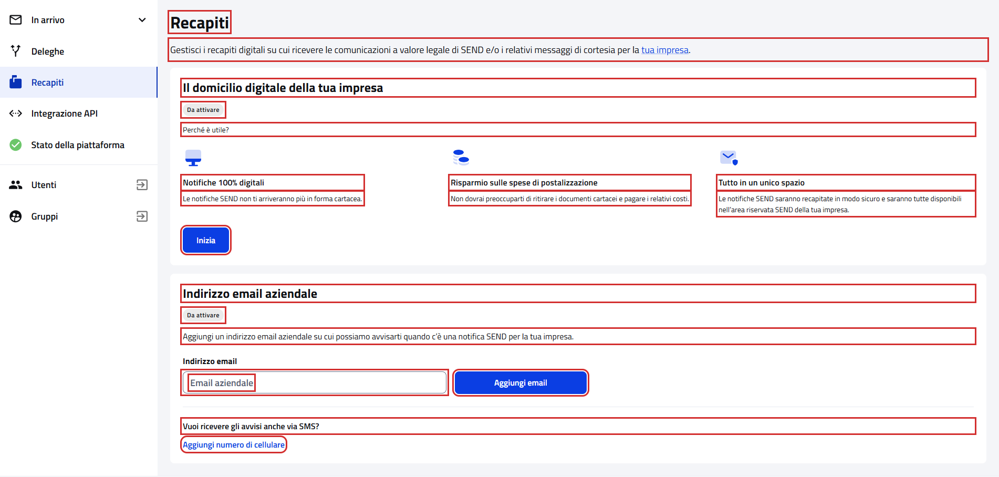
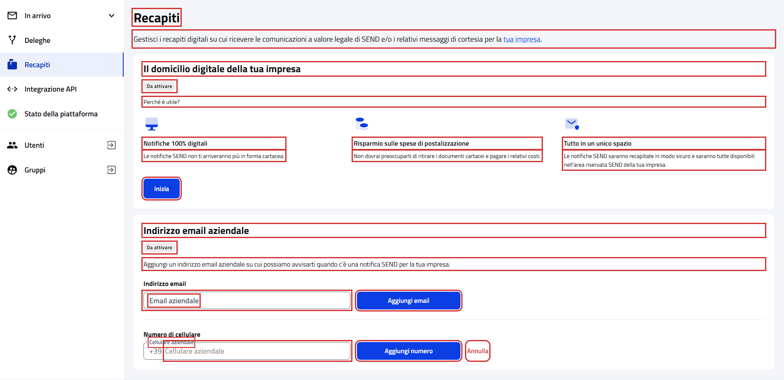
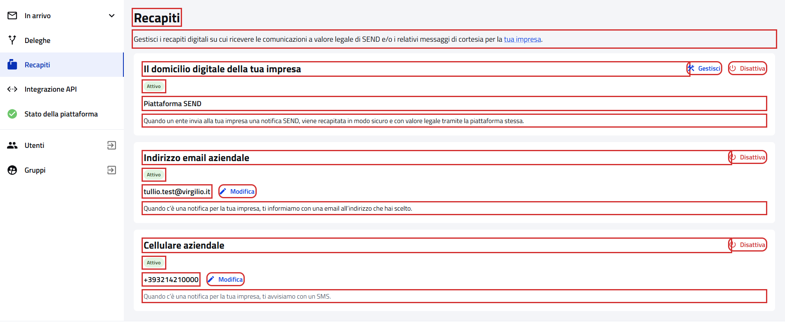

# Recapiti

Pagina `{baseUrl}/recapiti`, dalla voce "Recapiti" del menu laterale.

- Page object: [`AddressPGPage`](../../src/main/java/it/pagopa/send/web/destinatario_pg/infrastructure/page/AddressPGPage.java),
  con le card comuni al cittadino in [`RecipientAddressPage`](../../src/main/java/it/pagopa/send/web/address/infrastructure/suit/RecipientAddressPage.java)
- Test: [`WebAddressPGContractTest`](../../src/test/java/it/pagopa/send/suite/contract/destinatario_pg/WebAddressPGContractTest.java),
  con le validazioni comuni in [`RecipientAddressScenarios`](../../src/test/java/it/pagopa/send/suite/contract/RecipientAddressScenarios.java)
- Utente: Francesco Petrarca, amministratore di Le Epistolae srl
- Navigazione: `WebRecipientPgNavigationContractTest#shouldReachAddress`

## La pagina

In rosso quello che controlla `assertLoaded()`: il titolo e le card del domicilio digitale e dell'email aziendale.

## Cosa verifica il contract test

I testi della pagina, il contenuto di ogni card e i messaggi di validazione di email e cellulare. In rosso gli elementi
controllati, esclusi i messaggi di errore.

Recapiti da attivare (Petrarca):

Con "Aggiungi numero di cellulare" premuto:

Recapiti attivi:

## Varianti

Ogni card cambia con i recapiti dell'impresa e il test controlla quella che trova.

| Card | Recapito attivo | Da attivare |
|---|---|---|
| Domicilio digitale | "Piattaforma SEND" con descrizione, Gestisci e Disattiva | Perché è utile?, i tre vantaggi e Inizia |
| Email aziendale | email con Modifica e Disattiva | campo vuoto e Aggiungi email |
| Cellulare aziendale | card con Modifica e Disattiva | Aggiungi numero di cellulare, che apre il campo con Aggiungi numero e Annulla |

Le varianti attive sono state provate il 12/10/2026 con un'impresa che ha domicilio su SEND, email e cellulare.

## Note

- Rispetto al [cittadino](../pagine-pf/WebAddressPFContractTest.md) le card sono le stesse, con testi propri
  dell'impresa e senza la card di SEND sull'app IO.
- Il test non preme mai Disattiva, Gestisci o Inizia e nelle validazioni usa solo valori non validi.
- Screenshot presi sull'ambiente `test` a 1920x1080. Ultimo aggiornamento: 12/10/2026.
