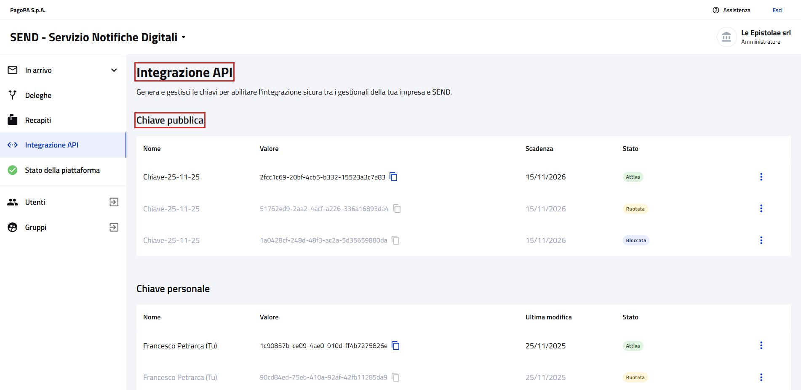
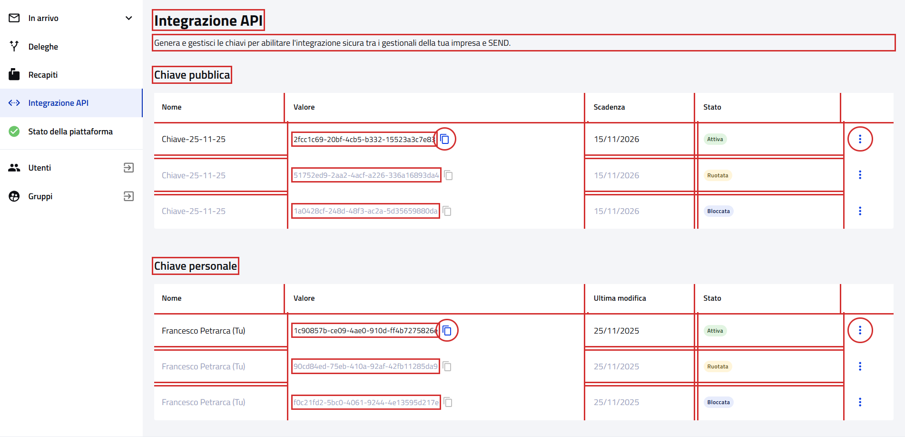
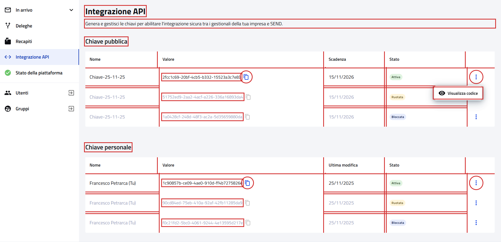
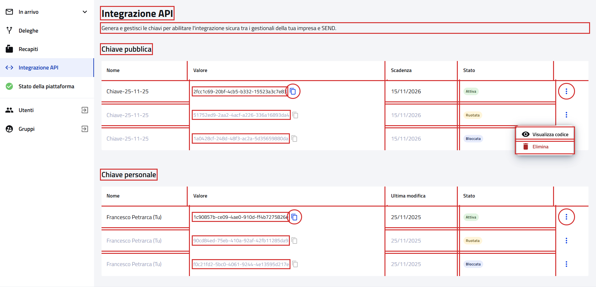
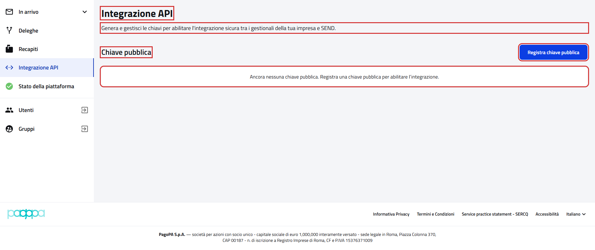
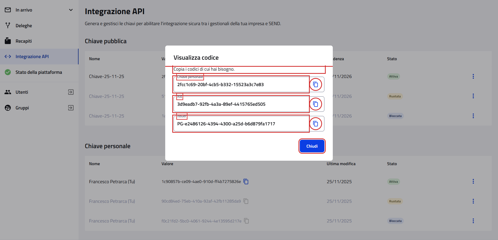
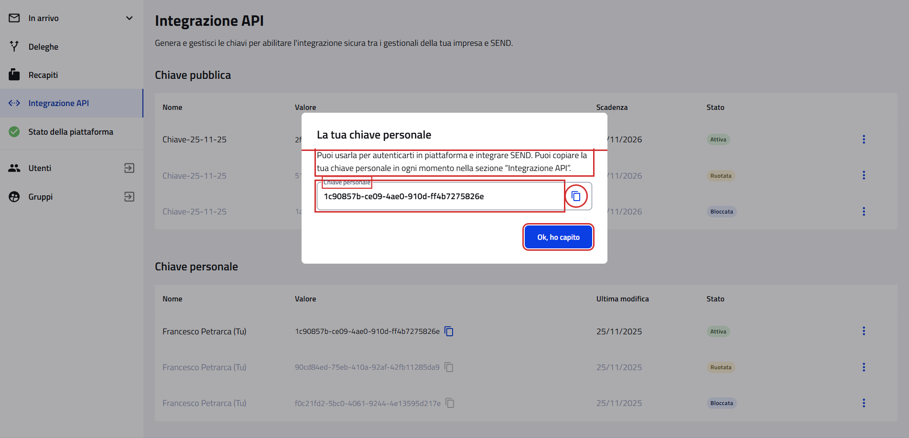

# Integrazione API

Pagina `{baseUrl}/integrazione-api`, dalla voce "Integrazione API" del menu laterale.

- Page object: [`ApiIntegrationPage`](../../src/main/java/it/pagopa/send/web/destinatario_pg/infrastructure/page/ApiIntegrationPage.java)
- Test: [`WebApiIntegrationPGContractTest`](../../src/test/java/it/pagopa/send/suite/contract/destinatario_pg/WebApiIntegrationPGContractTest.java)
- Utente: Francesco Petrarca, amministratore di Le Epistolae srl
- Navigazione: `WebRecipientPgNavigationContractTest#shouldReachApiIntegration`

## La pagina

In rosso quello che controlla `assertLoaded()`: il titolo e il titolo della sezione "Chiave pubblica".

## Cosa verifica il contract test

I testi della pagina; per ogni tabella le colonne, il formato delle righe e "Copia"; il menu "⋮" delle chiavi; la finestra
di "Visualizza codice" delle chiavi attive. In rosso gli elementi controllati.

Le tabelle delle chiavi:

Menu di una chiave attiva e di una chiave ruotata ("Elimina" non viene premuto):

Impresa senza chiavi ("Registra chiave pubblica" non viene premuto):

"Visualizza codice" della chiave pubblica e della chiave personale attive:

## Tabelle e menu

| Parte | Cosa si controlla |
|---|---|
| Colonne | "Chiave pubblica": Nome, Valore, Scadenza, Stato; "Chiave personale": Nome, Valore, Ultima modifica, Stato |
| Righe | nome non vuoto, valore in formato UUID, data `gg/mm/aaaa`, stato Attiva, Ruotata o Bloccata |
| Copia | attivo sulle chiavi attive, disabilitato sulle altre |
| Menu | chiave attiva: solo "Visualizza codice"; chiave ruotata o bloccata: "Visualizza codice" ed "Elimina" |
| Visualizza codice, chiave pubblica | "Visualizza codice", "Copia i codici di cui hai bisogno.", campi Chiave personale (il valore della riga), Kid (UUID) e Issuer (`PG-` con l'identificativo dell'impresa), ognuno con "Copia"; "Chiudi" chiude la finestra |
| Visualizza codice, chiave personale | "La tua chiave personale", testo, campo Chiave personale con "Copia"; "Ok, ho capito" chiude la finestra |

Il 13/10/2026 Petrarca aveva in ogni tabella una chiave attiva, una ruotata e una bloccata. Le chiavi possono cambiare:
ogni scenario controlla le righe che trova e termina se manca la tabella o la chiave nello stato che cerca.

## Varianti

| Impresa | Cosa mostra la pagina |
|---|---|
| Con chiavi (Petrarca) | le sezioni "Chiave pubblica" e "Chiave personale", ciascuna con la sua tabella |
| Senza chiavi | solo "Chiave pubblica", con "Registra chiave pubblica" e il messaggio "Ancora nessuna chiave pubblica. Registra una chiave pubblica per abilitare l’integrazione." al posto della tabella |

La variante senza chiavi è stata provata il 13/10/2026 con un'impresa che non ne ha. Il form di "Registra chiave
pubblica" è in [Registra chiave pubblica](WebPublicKeyRegistrationPGContractTest.md).

## Note

- Il test non preme mai "Elimina" o "Registra chiave pubblica" e non usa "Copia".
- Screenshot presi sull'ambiente `test` a 1920x1080. Ultimo aggiornamento: 13/10/2026.
