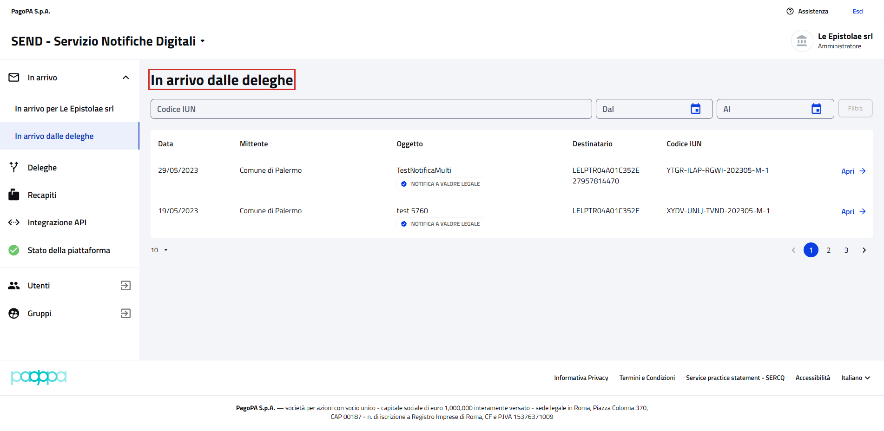
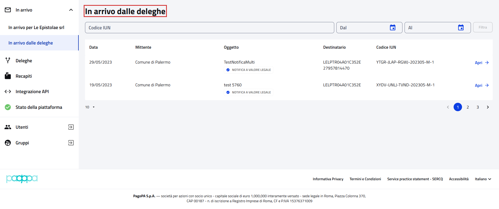
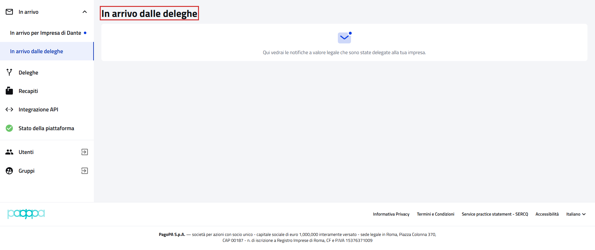

# In arrivo dalle deleghe

Pagina `{baseUrl}/notifiche-delegato`: le notifiche dei deleganti che hanno affidato una delega all'impresa. Si apre
dalla voce "In arrivo dalle deleghe" del menu laterale. `{baseUrl}` è la proprietà `url.notifiche.persona-giuridica.base`
del profilo attivo, ad esempio `https://imprese.test.notifichedigitali.it` sul profilo `test`.

- Ticket: QA-18350
- Page object: [`DelegatedNotificationPage`](../../src/main/java/it/pagopa/send/web/destinatario_pg/infrastructure/page/DelegatedNotificationPage.java)
- Test: [`WebDelegatedNotificationPGContractTest`](../../src/test/java/it/pagopa/send/suite/contract/destinatario_pg/WebDelegatedNotificationPGContractTest.java)
- Utente: Francesco Petrarca, amministratore di Le Epistolae srl
- Navigazione: `WebRecipientPgNavigationContractTest#shouldReachDelegatedNotification`
- Componente in pn-frontend: `packages/pn-personagiuridica-webapp/src/pages/Notifiche.page.tsx` con
  `isDelegatedPage`, versione `afedb936a9db15abe40c394056b3516c6e416fcb`

## La pagina

In rosso quello che controlla `assertLoaded()`: il titolo "In arrivo dalle deleghe".

## Cosa verifica il contract test

Solo quello che vale per tutti gli utenti: il titolo, e l'assenza dei componenti che sono solo in
[In arrivo per l'impresa](WebNotificationPGContractTest.md). Il resto della pagina cambia in base alle notifiche delegate
all'impresa (vedi sotto).

| Elemento | Proprietà | Atteso | Fonte |
|---|---|---|---|
| Titolo | Testo | "In arrivo dalle deleghe" | pn-frontend, `locales/it/notifiche.json`, chiave `title-delegated-notifications` |
| Filtro "Tipologia" | Presenza nel DOM | Assente | pn-frontend, `components/Notifications/FilterNotifications.tsx`, `showCommunicationType={!isDelegatedPage}` |
| Banner per attivare il domicilio digitale | Presenza nel DOM | Assente | pn-frontend, `Notifiche.page.tsx`, il banner richiede `!isDelegatedPage` |

## Perché non si verificano filtri e tabella

È lo stesso componente di [In arrivo per l'impresa](WebNotificationPGContractTest.md), aperto come pagina delle deleghe.
Nel codice (`Notifiche.page.tsx`, `components/Notifications/FilterNotifications.tsx` e `NotificationsEmptyState.tsx`)
solo il titolo è sempre presente, e il filtro "Tipologia" e il banner non ci sono mai:

| Elemento | Quando c'è |
|---|---|
| Titolo "In arrivo dalle deleghe" | sempre |
| Filtri (Codice IUN, Dal, Al, Filtra), senza "Tipologia" | solo se ci sono notifiche delegate (`showFilters = notifications.length > 0 \|\| filtersApplied`) |
| Tabella delle notifiche, con la colonna "Destinatario", e paginazione | solo se ci sono notifiche delegate |
| Messaggio "Qui vedrai le notifiche a valore legale che sono state delegate alla tua impresa." | solo se non ci sono notifiche delegate |
| Selettore del gruppo, accanto al titolo | solo se l'impresa ha dei gruppi |
| Filtro "Tipologia" | mai |
| Banner "Niente più documenti cartacei" | mai |

Con notifiche delegate (Francesco Petrarca, Le Epistolae srl): filtri e tabella.

Senza notifiche delegate (Dante Alighieri, Impresa di Dante): niente filtri né tabella, al loro posto il messaggio.

