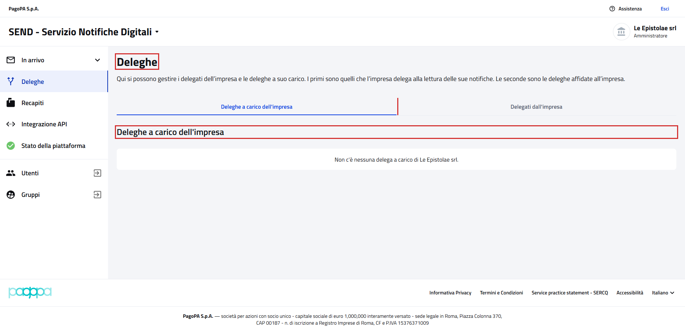
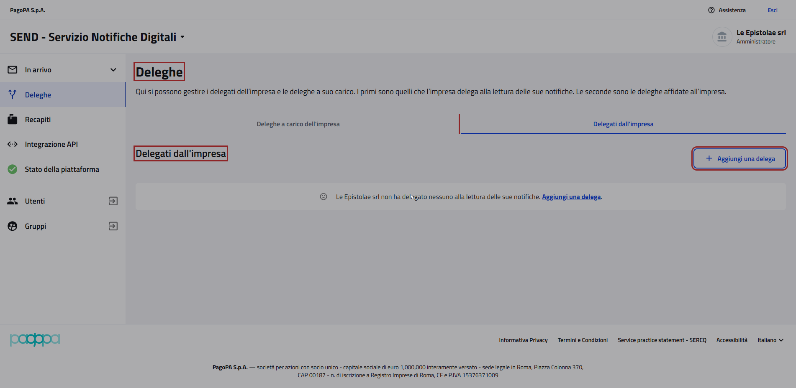
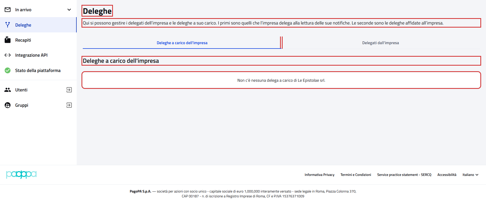
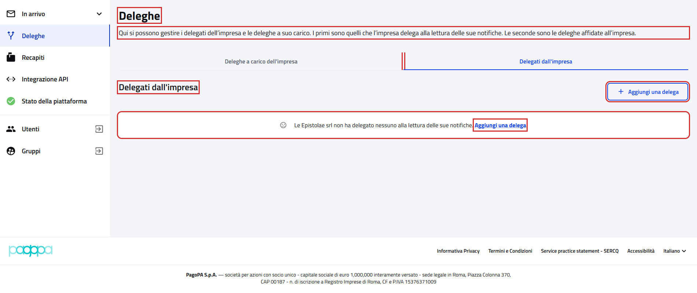

# Deleghe

Pagina "Deleghe" dell'impresa, con due schede:

- `{baseUrl}/deleghe/a-carico`, "Deleghe a carico dell'impresa": le deleghe affidate all'impresa. Si apre dalla voce
  "Deleghe" del menu laterale;
- `{baseUrl}/deleghe/delegati`, "Delegati dall'impresa": chi può leggere le notifiche dell'impresa.

Riferimenti:

- Page object: [`OrganizationDelegationsPage`](../../src/main/java/it/pagopa/send/web/destinatario_pg/infrastructure/page/OrganizationDelegationsPage.java)
  e [`OrganizationAuthorizedRepresentativesPage`](../../src/main/java/it/pagopa/send/web/destinatario_pg/infrastructure/page/OrganizationAuthorizedRepresentativesPage.java),
  con le parti comuni alle due schede in [`DelegationsPGPage`](../../src/main/java/it/pagopa/send/web/destinatario_pg/infrastructure/page/DelegationsPGPage.java)
- Test: [`WebDelegationsPGContractTest`](../../src/test/java/it/pagopa/send/suite/contract/destinatario_pg/WebDelegationsPGContractTest.java)
- Utente: Francesco Petrarca, amministratore di Le Epistolae srl
- Navigazione: `WebRecipientPgNavigationContractTest#shouldReachOrganizationDelegations` e
  `#shouldReachOrganizationAuthorizedRepresentatives`

## La pagina

In rosso quello che controlla `assertLoaded()`: il titolo, la scheda selezionata e il titolo della sezione; per
"Delegati dall'impresa" anche "Aggiungi una delega".

## Cosa verifica il contract test

Titolo, sottotitolo e schede, il passaggio da una scheda all'altra, il titolo e il messaggio di scheda vuota di
ciascuna scheda, il pulsante e il link "Aggiungi una delega" con la pagina che aprono. In rosso gli elementi
controllati.

## Note

- Le tabelle delle deleghe non sono verificate: l'utente di test non ha deleghe.
- Il test non crea, accetta o revoca deleghe.
- Screenshot presi sull'ambiente `test` a 1920x1080. Ultimo aggiornamento: 12/10/2026.
