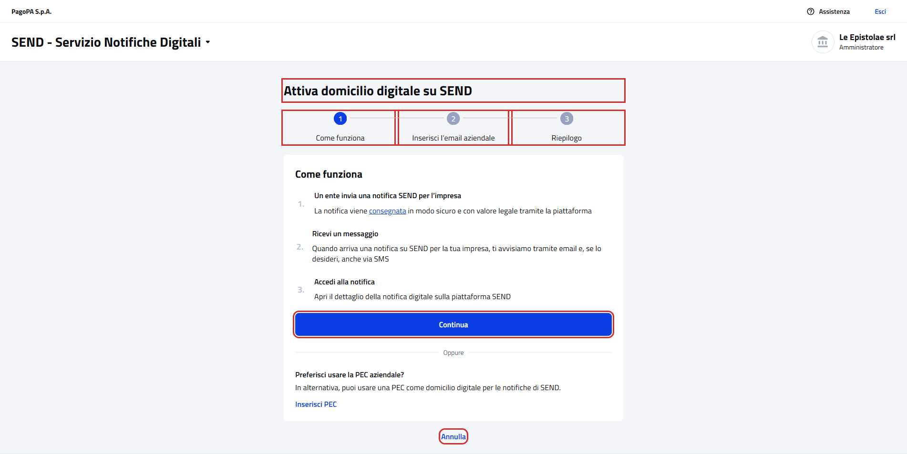
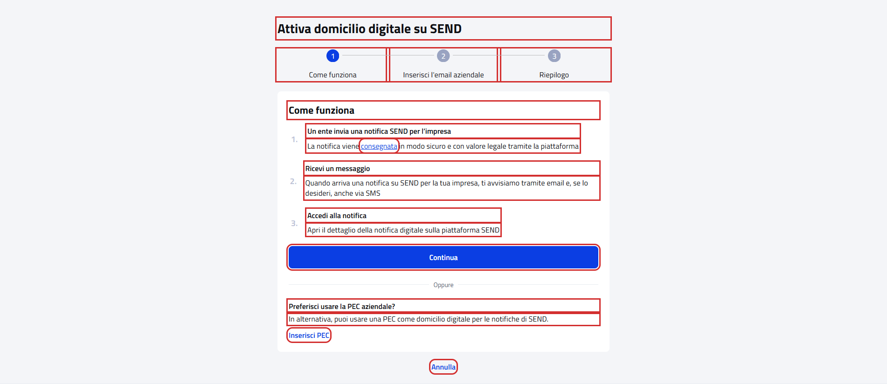
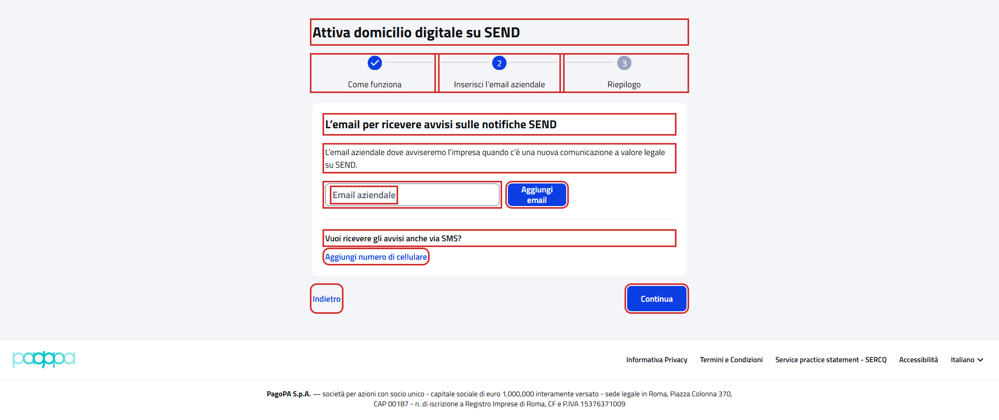
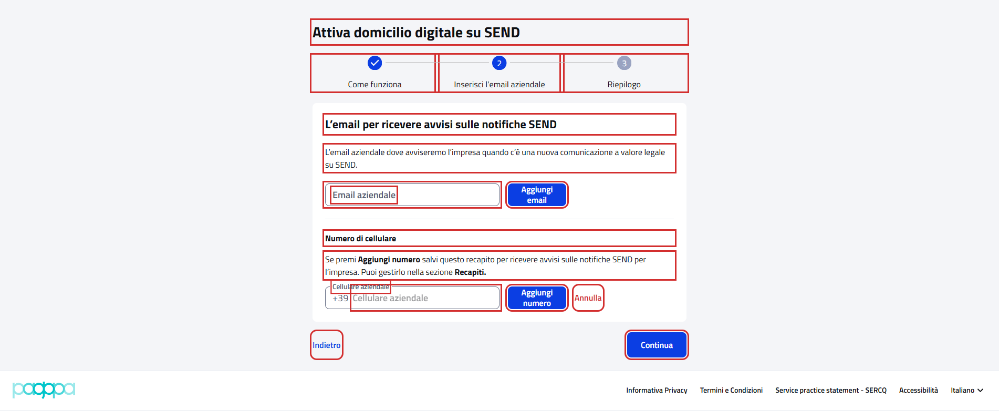
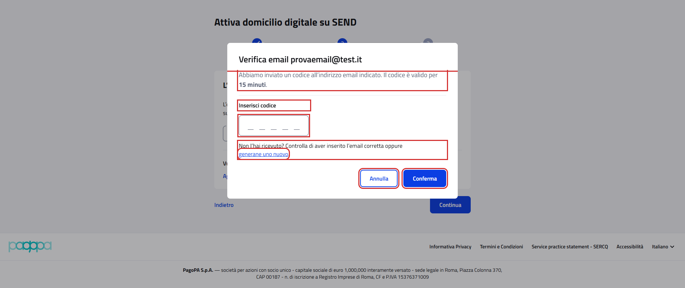

# Attiva domicilio digitale su SEND

Wizard `{baseUrl}/recapiti/domicilio-digitale/attivazione`, da "Inizia" nella card "Il domicilio digitale della tua
impresa" di [Recapiti](WebAddressPGContractTest.md).

- Page object: [`DigitalDomicileActivationPGPage`](../../src/main/java/it/pagopa/send/web/destinatario_pg/infrastructure/page/DigitalDomicileActivationPGPage.java),
  con il wizard comune al cittadino in [`DigitalDomicileActivationPage`](../../src/main/java/it/pagopa/send/web/address/infrastructure/suit/DigitalDomicileActivationPage.java)
- Test: [`WebDigitalDomicileActivationPGContractTest`](../../src/test/java/it/pagopa/send/suite/contract/destinatario_pg/WebDigitalDomicileActivationPGContractTest.java),
  con gli scenari comuni in [`DigitalDomicileActivationScenarios`](../../src/test/java/it/pagopa/send/suite/contract/DigitalDomicileActivationScenarios.java)
- Utente: Francesco Petrarca, amministratore di Le Epistolae srl
- Navigazione: `WebRecipientPgNavigationContractTest#shouldReachDigitalDomicileActivation`

## La pagina

In rosso quello che controlla `assertLoaded()`: il titolo del wizard, i tre passi, "Continua" e "Annulla".

## Cosa verifica il contract test

Il titolo e i nomi dei passi; per ogni passo testi e pulsanti; la finestra che si apre da "consegnata"; i messaggi di
validazione di email e cellulare al passo 2; la finestra del codice di verifica. In rosso gli elementi controllati,
esclusi i messaggi di errore e la finestra di "consegnata".

Passo 1, Come funziona, con la sezione per usare una PEC aziendale:

Passo 2, Inserisci l'email aziendale (Petrarca non ha recapiti):

Con "Aggiungi numero di cellulare" premuto:

Finestra del codice di verifica, dopo "Aggiungi email" con `provaemail@test.it`:

## Finestra del codice di verifica

"Aggiungi email" con un indirizzo valido fa inviare un codice e apre la finestra "Verifica email &lt;indirizzo&gt;". Il
test controlla:

- testi, campo "Inserisci codice" vuoto, "generane uno nuovo", "Annulla" e "Conferma", che non viene premuto;
- un codice con lettere (`abcde`, `12ab`): il campo lo rifiuta subito con "Questo campo accetta solo valori numerici" e
  "Controlla il codice di verifica e inseriscilo di nuovo";
- "generane uno nuovo": la finestra resta aperta, senza messaggi;
- "Annulla": la finestra si chiude e il wizard resta al passo 2, senza email salvata.

Ogni esecuzione manda due email di verifica a `provaemail@test.it`. La finestra del cellulare ("Verifica numero
&lt;numero&gt;") è uguale, con i testi del cellulare: gli scenari ci sono ma sono commentati con un TODO, perché
manderebbero due SMS a ogni esecuzione e non c'è un numero di test. Sono stati provati il 13/10/2026 con `348000000`.

## Riepilogo

Petrarca non ha un'email aziendale: al passo 2 il campo email è vuoto e "Continua" resta sul passo 2 senza messaggi,
quindi il riepilogo non si raggiunge e non è verificato (TODO nel test).

## Note

- Rispetto al [cittadino](../pagine-pf/WebDigitalDomicileActivationPFContractTest.md) il wizard è lo stesso, con testi
  propri dell'impresa: al passo 1 c'è la sezione "Preferisci usare la PEC aziendale?" e non c'è l'avviso sulla PEC.
- Il test non preme mai "Conferma" né "Inserisci PEC" e nelle validazioni dei recapiti usa solo valori non validi.
- Screenshot presi sull'ambiente `test` a 1920x1080. Ultimo aggiornamento: 13/10/2026.
