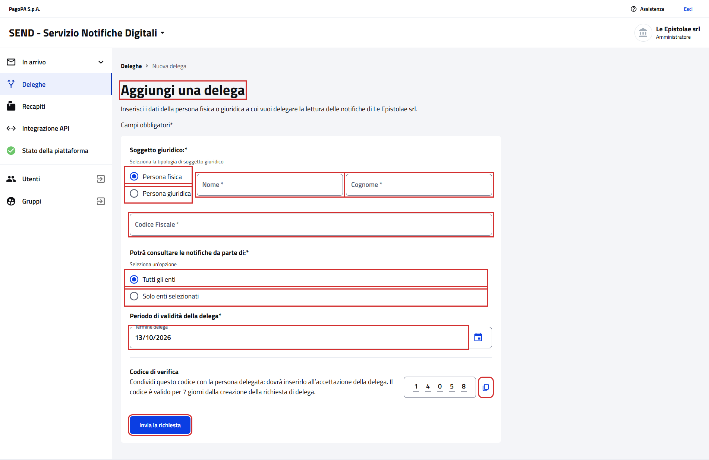
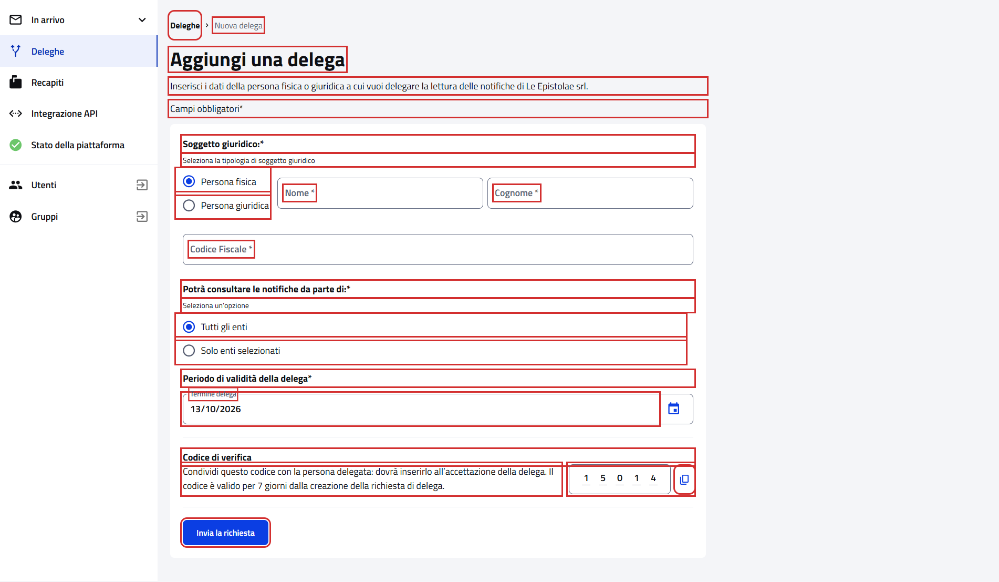
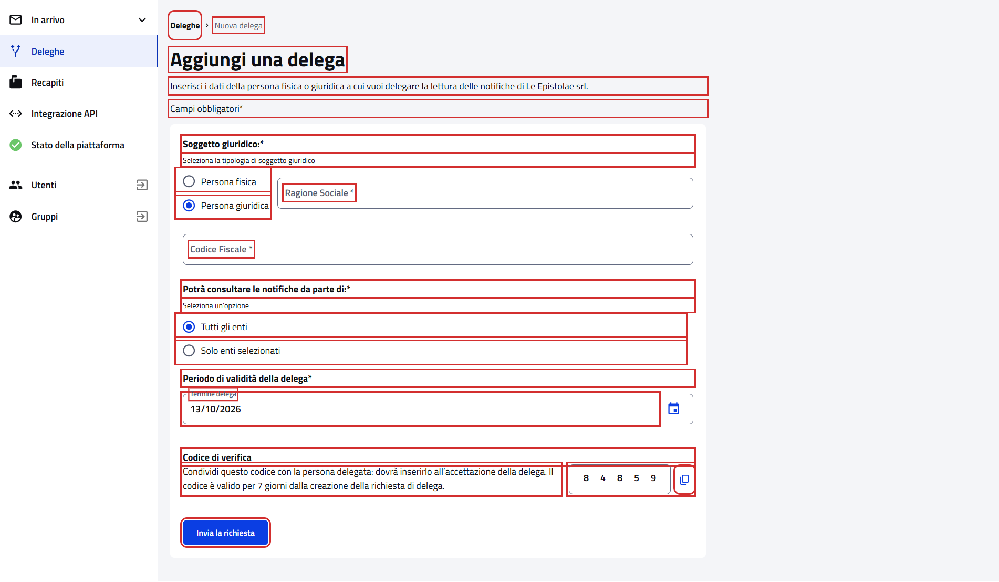
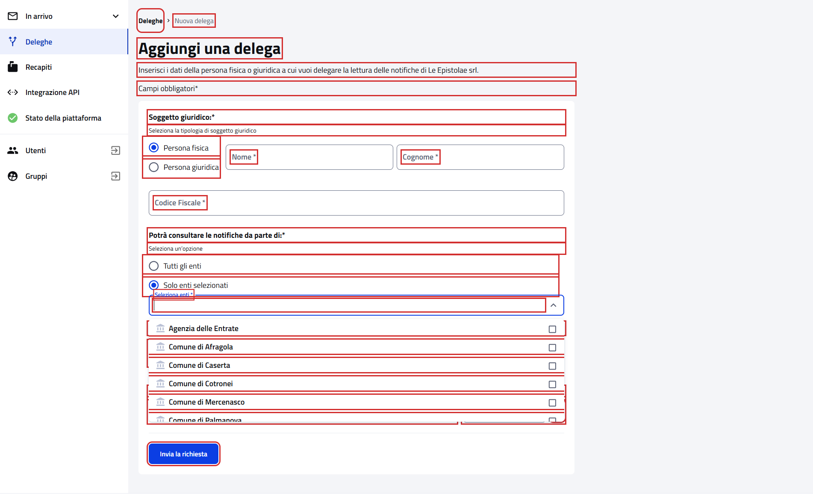

# Aggiungi una delega

Pagina `{baseUrl}/deleghe/delegati/nuova`, da "Aggiungi una delega" nella scheda "Delegati dall'impresa" della pagina
[Deleghe](WebDelegationsPGContractTest.md).

- Page object: [`NewDelegationPage`](../../src/main/java/it/pagopa/send/web/destinatario_pg/infrastructure/page/NewDelegationPage.java),
  con il form comune al cittadino in [`NewDelegationFormPage`](../../src/main/java/it/pagopa/send/web/delegation/infrastructure/suit/NewDelegationFormPage.java)
- Test: [`WebNewDelegationPGContractTest`](../../src/test/java/it/pagopa/send/suite/contract/destinatario_pg/WebNewDelegationPGContractTest.java),
  con gli scenari in [`NewDelegationScenarios`](../../src/test/java/it/pagopa/send/suite/contract/NewDelegationScenarios.java)
- Utente: Francesco Petrarca, amministratore di Le Epistolae srl
- Navigazione: `WebRecipientPgNavigationContractTest#shouldReachNewDelegation`

## La pagina

In rosso quello che controlla `assertLoaded()`: il titolo, i campi e i pulsanti del form.

## Cosa verifica il contract test

Gli stessi scenari del [form del cittadino](../pagine-pf/WebNewDelegationPFContractTest.md): testi, codice di verifica,
valori iniziali, campi che cambiano con le scelte e messaggi di validazione. Rispetto al cittadino cambia il
sottotitolo, che nomina l'impresa. In rosso gli elementi controllati, esclusi i messaggi di errore delle validazioni, che compaiono
solo dopo aver compilato il form.

All'apertura:

Con "Persona giuridica":

Con "Solo enti selezionati" e l'elenco degli enti aperto:

## Note

- Il test non crea mai una delega: quando preme "Invia la richiesta" il codice fiscale non è valido.
- Screenshot presi sull'ambiente `test` a 1920x1080. Ultimo aggiornamento: 12/10/2026.
