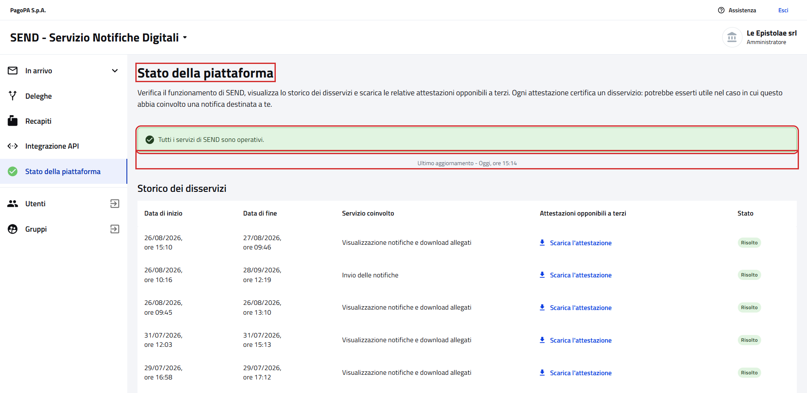
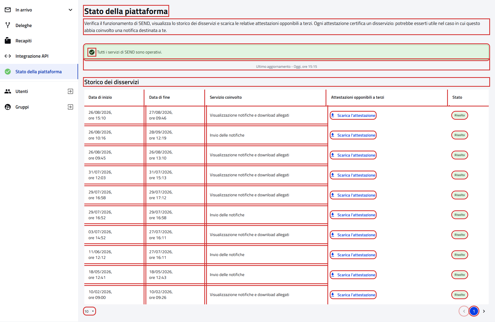

# Stato della piattaforma

Pagina `{baseUrl}/app-status`, dalla voce "Stato della piattaforma" del menu laterale.

- Page object: [`PlatformStatusPage`](../../src/main/java/it/pagopa/send/web/destinatario_pg/infrastructure/page/PlatformStatusPage.java),
  con la pagina comune al cittadino in [`AppStatusPage`](../../src/main/java/it/pagopa/send/web/app_status/infrastructure/suit/AppStatusPage.java)
- Test: [`WebPlatformStatusPGContractTest`](../../src/test/java/it/pagopa/send/suite/contract/destinatario_pg/WebPlatformStatusPGContractTest.java),
  con gli scenari in [`AppStatusScenarios`](../../src/test/java/it/pagopa/send/suite/contract/AppStatusScenarios.java)
- Utente: Francesco Petrarca, amministratore di Le Epistolae srl
- Navigazione: `WebRecipientPgNavigationContractTest#shouldReachPlatformStatus`

## La pagina

In rosso quello che controlla `assertLoaded()`: il titolo, lo stato attuale e l'ultimo aggiornamento.

## Cosa verifica il contract test

Gli stessi scenari della [pagina del cittadino](../pagine-pf/WebAppStatusPFContractTest.md), che ha gli stessi testi:
intestazione, stato attuale dei servizi con l'ora dell'ultimo aggiornamento e storico dei disservizi con la
paginazione. In rosso gli elementi controllati.

## Note

- Il test non scarica le attestazioni.
- Screenshot presi sull'ambiente `test` a 1920x1080. Ultimo aggiornamento: 12/10/2026.
