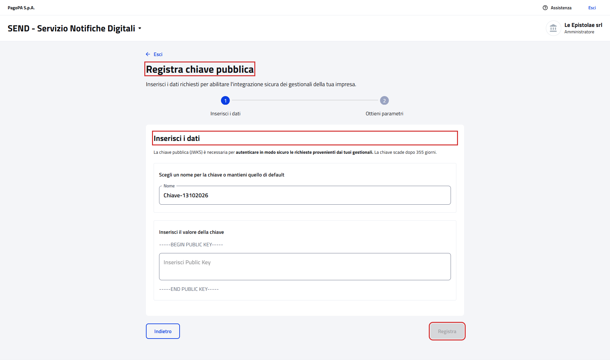
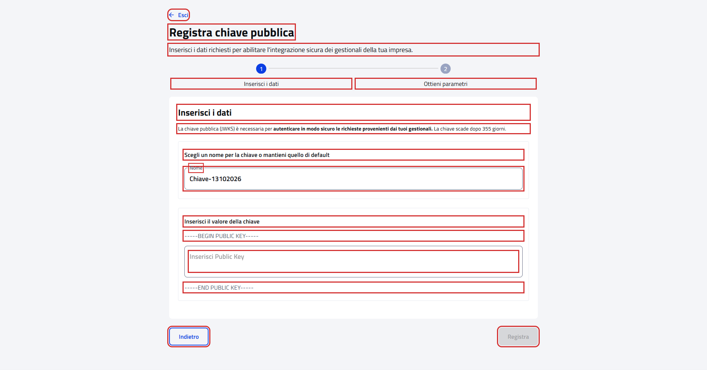
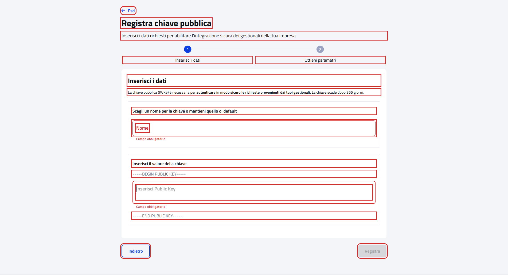

# Registra chiave pubblica

Pagina `{baseUrl}/integrazione-api/registra-chiave-pubblica`, da "Registra chiave pubblica" della pagina
[Integrazione API](WebApiIntegrationPGContractTest.md).

- Page object: [`PublicKeyRegistrationPage`](../../src/main/java/it/pagopa/send/web/destinatario_pg/infrastructure/page/PublicKeyRegistrationPage.java)
- Test: [`WebPublicKeyRegistrationPGContractTest`](../../src/test/java/it/pagopa/send/suite/contract/destinatario_pg/WebPublicKeyRegistrationPGContractTest.java)
- Utente: Francesco Petrarca, amministratore di Le Epistolae srl

## La pagina

In rosso quello che controlla `assertLoaded()`: il titolo, il titolo del passo e "Registra".

## Cosa verifica il contract test

Il primo passo, "Inserisci i dati": testi, stato iniziale del form e messaggi dei campi obbligatori. In rosso gli
elementi controllati.

Nome e valore della chiave svuotati: sotto ogni campo compare "Campo obbligatorio".

| Parte | Cosa si controlla |
|---|---|
| Testata | titolo, sottotitolo, "Esci" e "Indietro" |
| Passi | "Inserisci i dati" (quello attivo) e "Ottieni parametri" |
| Passo "Inserisci i dati" | titolo, testo con la durata della chiave in giorni, testi del form, etichetta "Nome" |
| Stato iniziale | nome già compilato con "Chiave-" e la data del giorno (`ggmmaaaa`), valore della chiave vuoto, "Registra" disabilitato |
| Valore della chiave svuotato | "Campo obbligatorio", "Registra" disabilitato |
| Nome svuotato | "Campo obbligatorio", "Registra" disabilitato |

## Note

- Il test apre la pagina dal suo indirizzo e non preme mai "Registra", "Esci" o "Indietro": il passo "Ottieni
  parametri" non viene raggiunto.
- Il 13/10/2026 la chiave scadeva dopo 355 giorni; il test controlla solo che sia un numero di giorni.
- Screenshot presi sull'ambiente `test` a 1920x1080. Ultimo aggiornamento: 13/10/2026.
