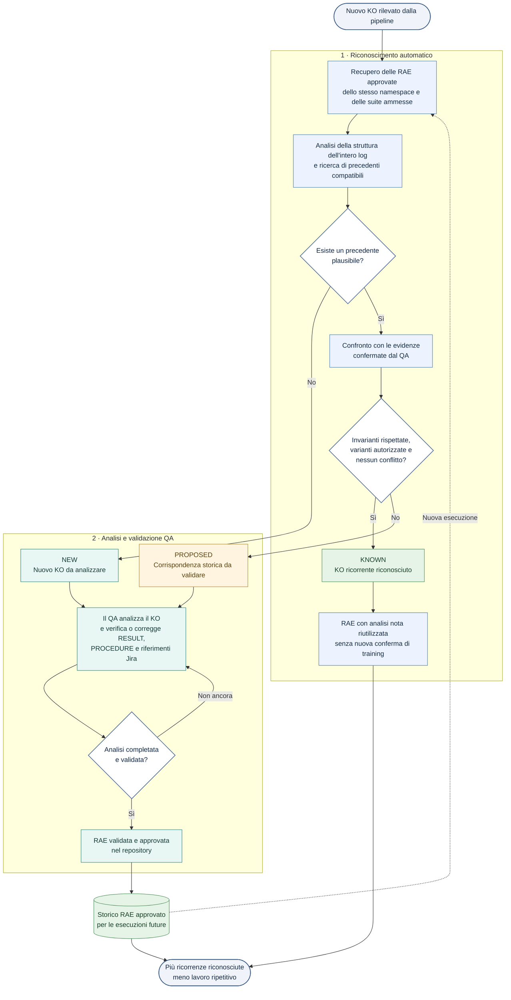

# RAE — Processo di riconoscimento progressivo dei KO

> **Scopo del processo:** ridurre le analisi ripetitive riconoscendo i fallimenti già studiati, senza trasformare una semplice somiglianza in un'associazione automatica a un difetto. La conoscenza cresce attraverso le verifiche effettuate dal QA e le RAE approvate.

**Destinatari:** analisti QA, responsabili di qualità, team di sviluppo e referenti di prodotto.  
**Ambito:** riconoscimento dei KO e apprendimento dalle analisi precedenti. Per l'installazione e l'integrazione di una nuova pipeline, consultare [README.md](README.md).

## 1. Il processo in una vista

Il flusso si divide in **due responsabilità**: a sinistra il sistema confronta il nuovo KO con lo storico; a destra il QA prende in carico i casi per i quali non è possibile decidere automaticamente. Le analisi approvate alimentano lo storico utilizzabile nelle esecuzioni successive.



**Come leggere le frecce:** `KNOWN` è la decisione automatica più restrittiva; `PROPOSED` conserva una possibile analisi precedente ma chiede una verifica; `NEW` non dispone di un precedente plausibile. Il ritorno allo storico **non è apprendimento immediato durante la run**: diventa disponibile nelle esecuzioni future quando l'analisi soddisfa le condizioni di approvazione e viene inclusa nello storico letto dal generatore.

## 2. La sequenza operativa, dall'esecuzione al riutilizzo

### Passaggio 1 — La pipeline rileva un KO

La suite esegue i test e produce i report degli esiti. Il generatore RAE identifica i fallimenti, ne raccoglie il log e costruisce un documento YAML con informazioni sulla run e singole occorrenze da analizzare.

**Per il QA:** il KO è un'evidenza dell'esecuzione, **non è ancora** la diagnosi della causa. Due KO con lo stesso nome del test possono derivare da difetti diversi.

### Passaggio 2 — Il sistema consulta lo storico attendibile

Il generatore recupera RAE già presenti nel checkout di `develop`, limitatamente al **namespace della pipeline** (ad esempio `interop`), alla suite pertinente e alle eventuali suite generali ammesse dalla politica di ricerca. Non apprende da altre pipeline, da PR non ancora integrate o da un numero illimitato di esecuzioni.

**Per il QA:** se una nuova analisi è ancora soltanto in una Draft PR, non è un precedente approvato utilizzabile da una run successiva. Il riferimento allo storico è tracciabile alla RAE di origine.

### Passaggio 3 — L'automazione cerca un precedente plausibile

Il sistema confronta l'identificativo del test e la diagnostica del fallimento, individuando possibili strutture ricorrenti. Drain3 contribuisce alla ricerca di somiglianze strutturali: **appartenere allo stesso cluster non prova che si tratti dello stesso difetto**.

Se non emerge alcun candidato affidabile, l'esito è **`NEW`**: si procede con una nuova analisi.

### Passaggio 4 — Il candidato viene confrontato con le conferme QA

Se esiste un precedente plausibile, interviene il controllo più importante: il matcher verifica che il log corrente rispetti quanto appreso dalle occorrenze precedentemente confermate dal QA.

In particolare considera:

- le **invarianti**, ossia parti del log che nelle evidenze approvate non sono cambiate;
- le **varianti già confermate**, ossia cambiamenti osservati e accettati entro la struttura pertinente;
- le **nuove variazioni**, che non possono essere autorizzate solo perché il resto del testo è simile;
- i **conflitti tra difetti diversi**, che impediscono di scegliere arbitrariamente un ticket.

Il controllo riguarda **l'intero testo del log**, non soltanto il messaggio iniziale o lo stack trace. L'algoritmo non deve conoscere il significato applicativo di percorsi, identificativi, step Cucumber o stringhe del prodotto.

### Passaggio 5 — Il sistema sceglie l'esito

| Esito del matcher | Cosa significa per il business | Cosa compare nella RAE | Azione QA |
| --- | --- | --- | --- |
| **`KNOWN`** | Il KO rispetta un modello confermato e non presenta ambiguità bloccanti. | Analisi storica riutilizzata; se esiste il ticket appropriato, il KO può essere raggruppato fra i bug noti. | Controllo ordinario; nessuna nuova conferma necessaria per quella firma. |
| **`PROPOSED`** | È stato individuato un possibile precedente, ma serve una decisione umana per una differenza o un conflitto. | `RESULT` e `PROCEDURE` possono essere precompilati; il pannello **«Corrispondenza storica da validare»** mostra i motivi utili. | Confermare l'equivalenza, correggere l'analisi o documentare un difetto diverso. |
| **`NEW`** | Non è stato trovato un precedente plausibile. | KO da analizzare, senza analisi storica attribuita. | Effettuare e documentare la prima analisi. |

**Regola di sicurezza:** `PROPOSED` non equivale a `KNOWN`. Un ticket precompilato, una similarità elevata o una conferma storica isolata non bastano a promuovere automaticamente il KO.

### Passaggio 6 — Il QA prende la decisione

Quando serve intervento umano, l'analista studia il log, confronta il precedente suggerito e verifica le evidenze. Compila o corregge:

- **RESULT:** conclusione dell'analisi e motivazione del KO, in forma chiara e sintetica;
- **PROCEDURE:** verifiche svolte per arrivare alla conclusione;
- **link ai ticket:** associazione a un bug di prodotto o di suite, quando pertinente.

Il QA può **confermare il precedente** oppure **correggere la proposta**: il fatto che il generatore abbia precompilato un'analisi non obbliga ad accettarla. Anche un KO nuovo richiede una propria conclusione documentata.

### Passaggio 7 — La RAE viene validata e approvata

La RAE è conservata in YAML; il Markdown è una rappresentazione generata in modo deterministico. Il workflow valida i dati richiesti e la coerenza del documento, quindi produce il Markdown nella PR.

La tracciabilità delle conferme distingue un effettivo intervento QA da un aggiornamento automatico. **Un commit del bot, da solo, non costituisce una conferma umana.** Le condizioni precise della conferma sono gestite dalla policy di approvazione della RAE.

### Passaggio 8 — Le esecuzioni successive possono beneficiare dell'analisi

Dopo che una RAE valida è entrata nello storico approvato, il matcher può utilizzare le nuove conferme per ricostruire o ampliare il modello del difetto.

Il beneficio è progressivo: alcune variazioni che in passato richiedevano verifica diventano riconoscibili automaticamente, **ma solo entro i vincoli realmente supportati dalle evidenze**.

## 3. Che cosa impara realmente il sistema

Il modello non cerca di memorizzare una stringa immutabile per ogni errore e non sostituisce tutto ciò che cambia con un generico carattere jolly. Cerca invece un equilibrio fra riconoscere i cambiamenti già giustificati e preservare le parti che distinguono i difetti.

| Concetto | Significato | Implicazione |
| --- | --- | --- |
| **Invariante** | Porzione del log rimasta stabile negli esempi confermati. | Un nuovo valore può richiedere `PROPOSED`. |
| **Variante osservata** | Valore diverso già presente nello storico QA della famiglia corretta. | È un'evidenza utilizzabile nel confronto. |
| **Generalizzazione progressiva** | Possibilità di riconoscere nuovi valori coerenti con un modello appreso da più esempi. | Non autorizza valori o combinazioni arbitrarie. |
| **Famiglia strutturale** | Una delle forme in cui può presentarsi uno stesso difetto. | Stack diversi dello stesso difetto non vanno mescolati indiscriminatamente. |
| **Conflitto storico** | Più difetti distinti risultano compatibili con il KO. | L'assegnazione automatica viene bloccata. |

### Esempio A — Una parola o un numero cambia

Nelle RAE approvate il log riporta sempre:

```text
negli ultimi 40 minuti
```

Nella nuova esecuzione compare:

```text
negli ultimi 44 minuti
```

Il sistema individua `40 → 44`: è una parte precedentemente stabile che ora cambia. **Non può assumere automaticamente che i due KO siano equivalenti**. Se l'allineamento è affidabile, il QA vede anche il contesto «negli ultimi 40 minuti» → «negli ultimi 44 minuti»; se non lo è, vede soltanto i valori `40` e `44`.

Lo stesso criterio vale per `/aws/ecs/pn-national-registries` → `/aws/ecs/pn-national-registriez`: non esiste una regola speciale per AWS né per le righe che seguono lo stack.

### Esempio B — Uno stesso difetto ha due forme

Il QA ha ricondotto allo stesso difetto tre occorrenze:

| Famiglia osservata | Esempi confermati |
| --- | ---: |
| `ConditionTimeoutException` con stack di 14 frame | 1 |
| `AssertionFailedError` con stack di 5 frame | 2 |

Il sistema non deve giudicare errata la forma da 14 frame soltanto perché esistono anche esempi da 5. Confronta il log con la **famiglia strutturale pertinente**.

Questo non significa però che una nuova variazione dei frame, mai confermata, sia automaticamente ammessa. Inoltre, l'approvazione di due strutture alternative non rende lecita qualsiasi combinazione dei loro elementi.

### Esempio C — Più difetti sembrano compatibili

Se un KO è compatibile sia con un precedente associato a `QA-100` sia con uno associato a `QA-104`, il sistema **non sceglie il ticket più recente, il più frequente o il primo trovato**. Richiede una verifica QA, anche quando una delle corrispondenze sembra molto convincente.

Il conflitto impedisce la promozione automatica: è una protezione voluta contro l'attribuzione di un difetto sbagliato.

### Esempio D — Nuove conferme ampliano le possibilità

1. In una prima RAE il QA conferma una determinata struttura di errore.
2. Una nuova run contiene una variazione non ancora autorizzata: `PROPOSED`.
3. Il QA verifica l'equivalenza e conferma l'analisi.
4. Dopo l'approvazione e l'inclusione nello storico, le conferme disponibili vengono utilizzate per aggiornare le strutture apprese.
5. Una run successiva **può** diventare `KNOWN` se rispetta il modello aggiornato e supera tutti gli altri controlli.

La conferma di un solo valore nuovo **non equivale** all'autorizzazione indiscriminata di qualsiasi altro valore.

## 4. Che cosa vede concretamente il QA nel report

Il Markdown mantiene la gerarchia già presente nella RAE: titolo del report, gruppi di KO, titolo del singolo test, `RESULT`, `PROCEDURE`, eventuali link e `ERROR LOG`.

Per un `PROPOSED`, prima di `RESULT` compare un **unico riquadro informativo espandibile**, intitolato **«Corrispondenza storica da validare»**. Il riepilogo indica quante evidenze specifiche richiedono attenzione; aprendolo, l'analista vede i confronti disponibili.

Esempio schematico di contenuto:

> **⚠️ Corrispondenza storica da validare — 2 variazioni da verificare**
>
> **1. Invariante modificata** — Storico QA: `40`; log corrente: `44`.  
> Contesto, quando affidabile: «negli ultimi 40 minuti» → «negli ultimi 44 minuti».
>
> **2. Invariante modificata** — `/aws/ecs/pn-national-registries` → `/aws/ecs/pn-national-registriez`.

**Principio di leggibilità:** un solo riquadro per KO, non una sequenza di avvisi separati. Se le differenze specifiche spiegano già la richiesta di verifica, il report **non aggiunge** una frase generica come «Stack già osservato: non ci sono sufficienti evidenze per generalizzare le nuove variazioni». Le motivazioni tecniche rimangono disponibili al motore, ma il report privilegia le informazioni utili a decidere.

Per `NEW` non si inventa un precedente. Per `KNOWN` non è necessario aggiungere la scritta «MATCH AUTOMATICO CON PRECEDENTE CONFERMATO» nel dettaglio del KO.

> **Stato delle funzionalità:** gli esempi qui sopra descrivono il comportamento atteso della presentazione QA dopo le modifiche al renderer concordate. I dettagli esatti possono dipendere dalla versione integrata in `develop`: questa guida non sostituisce una verifica del Markdown generato nella PR.

## 5. Quali eventi contribuiscono all'apprendimento?

| Evento | Può ampliare la conoscenza del matcher? | Perché |
| --- | --- | --- |
| Nuovo KO rilevato dalla pipeline | **No** | È un'osservazione non verificata. |
| `PROPOSED` generato automaticamente | **No** | È soltanto un'ipotesi. |
| `KNOWN` riconosciuto automaticamente | **No, da solo** | Evita l'auto-rinforzo di un eventuale errore. |
| Analisi verificata dal QA e riconosciuta dalla policy di conferma, poi inclusa nello storico approvato | **Sì** | Aggiunge evidenza umana con provenienza verificabile. |
| Modifica automatica del Markdown da parte del workflow | **No** | È un'operazione di pubblicazione, non una decisione QA. |
| Analisi ancora su un branch non integrato | **Non nelle run che leggono `develop`** | Il generatore non la vede nello storico attendibile. |

## 6. Responsabilità e limiti

**Automazione.** Cerca somiglianze, verifica le invarianti e i vincoli appresi, blocca le ambiguità e precompila le analisi quando possibile. Non determina autonomamente la causa reale del difetto.

**Analista QA.** Valuta le evidenze, conferma o corregge la proposta, distingue bug di prodotto e bug di suite e documenta in modo comprensibile la conclusione.

**Repository e workflow.** Tracciano provenienza, revisione e approvazione della RAE; verificano che lo YAML possa produrre un Markdown coerente e ripetibile.

**Storico.** È limitato ai file effettivamente consultati dal generatore nel namespace e nelle suite consentite. Non è una memoria illimitata di tutte le esecuzioni.

**Principio finale:** è preferibile chiedere una verifica QA in più piuttosto che classificare automaticamente un KO con il ticket sbagliato. Il successo del processo è **meno lavoro ripetitivo, senza perdere il controllo sulla qualità delle associazioni**.

---

**Approfondimenti:** per avviare la RAE su un nuovo progetto, configurare GitHub Actions, recuperare `run_metadata.json` o rigenerare YAML e Markdown, consultare [README.md](README.md). Questo documento descrive invece **perché** e **quando** il sistema riconosce un KO.
